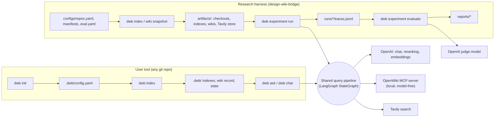
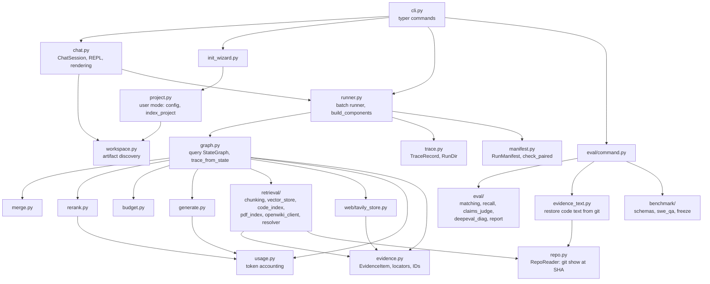
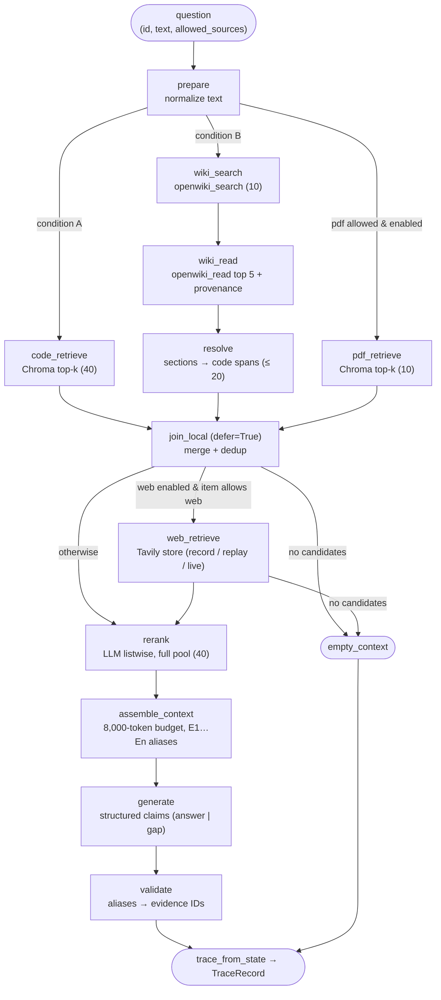
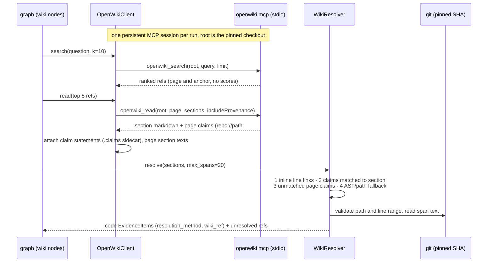
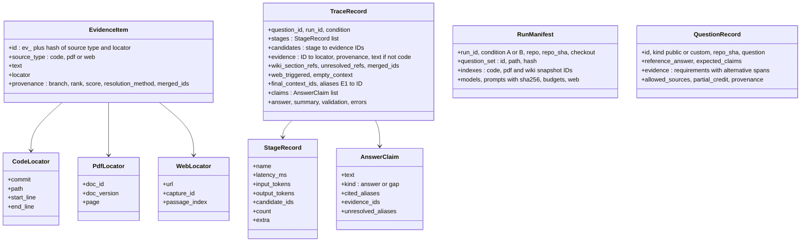
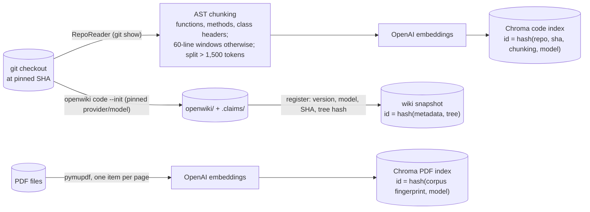
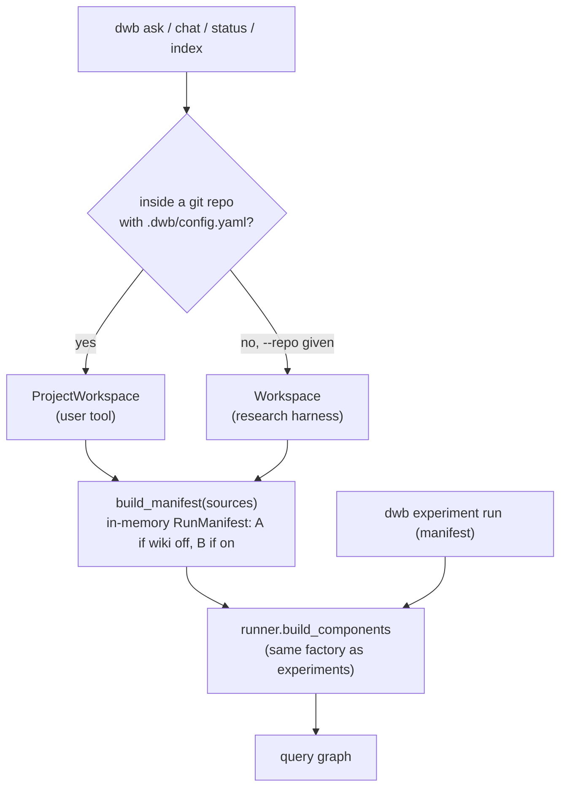
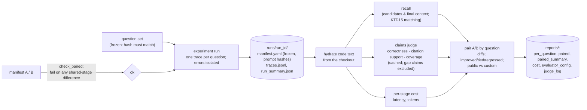

# dwb architecture

`dwb` answers questions about a software repository with citations to original evidence: code at a commit, PDF pages, and web passages. The same pipeline serves two purposes:

- a **user tool** you run inside any git repository (`dwb init` → `dwb index` → `dwb chat`);
- a **research harness** that compares two ways of finding repository evidence, vector search (condition A) and OpenWiki-guided search (condition B), on a frozen question set, with offline evaluation.

This document describes the components, how data flows through them, and the design decisions behind them. Usage is in [`usage.md`](usage.md), the study design in [`journal-extension-plan.md`](journal-extension-plan.md), the implementation plan in [`plans/`](plans/), and the empirical findings behind several decisions in [`spikes/2026-11-openwiki-swe-qa-spike.md`](spikes/2026-11-openwiki-swe-qa-spike.md) (cited below as *spike §n*).

## 1. System context

The repository is always a source. The wiki, PDFs, and the web are optional, and each is switched per run (research) or per question (user tool). Everything outside this diagram is local: git, Chroma, the PDF files, and the trace files.

## 2. Code map

The evaluator (`eval/`) never imports the graph, the generator, the reranker, or the retrievers; a test enforces this. It reads only traces, question records, and git.

## 3. The query graph

One explicit LangGraph `StateGraph`, compiled per run or session for one repository branch (condition A or B):

- **Routing is deterministic.** Conditional edges read only the manifest and the item's `allowed_sources`; no model decides which branches run.
- **The local branches run in parallel.** List-valued state (`stages`, `repo_candidates`, `pdf_candidates`, `unresolved_refs`, `errors`) uses `Annotated[list, operator.add]` reducers. `join_local` is added with `defer=True`, so it runs once after every active branch has finished.
- **The web is evaluated after the join.** The web fallback rule is applied in one place, identically for both conditions.
- **There is no fallback between repository branches.** If condition B finds nothing and no other source is enabled, the graph ends at `empty_context` rather than quietly switching to vector search.
- **Execution is `ainvoke`,** with no checkpointer and no streaming. Each node returns a `StageRecord` (latency, counts, tokens, stage-specific extras).

## 4. Condition B in detail

Wiki text never becomes evidence. It only guides discovery, and its section references are kept in the trace. Every span the resolver emits is original code at the pinned commit.

## 5. Data model

**Traces store code passages by reference.** Code passages carry no text in persisted traces: the text is exactly `git show <commit>:<path>` sliced to the lines, and `evidence_text.hydrate` restores it for evaluation. PDF and web text stay inline for the final context.

## 6. Build pipeline and artifacts

| | Research harness | User tool |
|---|---|---|
| Configuration | `configs/repos.yaml`, `configs/chat.yaml`, `configs/manifests/*.yaml`, `configs/eval.yaml` | `<repo>/.dwb/config.yaml` (written by `dwb init`) |
| Code | `artifacts/checkouts/<repo>-<tag>/` (shallow, single commit) | the repository itself, at HEAD |
| Indexes | `artifacts/indexes/<index_id>/` | `.dwb/index/<index_id>/` |
| Wiki | snapshot copied in `artifacts/wikis/<id>/`, restored into the checkout before a run | `openwiki/` used in place; record in `.dwb/wiki.json` |
| Web cache | `artifacts/tavily/<store_id>/` | `.dwb/tavily/chat-<name>/` |
| Run outputs | `runs/<run_id>/` (manifest, traces, summary), `reports/` | none (chat is not persisted) |
| Hidden from git | `.gitignore` (`artifacts/`, `runs/`, `reports/`) | `.git/info/exclude` (`/.dwb/`) |

Indexes are content-addressed. Building again with the same inputs reuses the existing index and never silently rebuilds it, and `dwb ask`/`chat`/`status` find indexes by repository, commit, and embedding model, so users never handle index IDs.

## 7. Two modes over one pipeline

`ask` and `chat` build an in-memory manifest from the source switches and run the same components and graph as `experiment run`. Answers in chat are therefore produced exactly as in the study. The workspace differs between the two modes only in where artifacts live and whether the wiki snapshot is restored (research) or used in place (user tool).

## 8. Research run and evaluation

## 9. Main design decisions

IDs refer to the implementation plan (KTD) or the spike document (§).

| # | Decision | Rationale | Rejected alternatives |
|---|---|---|---|
| 1 | **Explicit `StateGraph` with deterministic routing** (KTD11) | The two conditions must be controlled and comparable; an agent choosing tools would add an uncontrolled variable | Deep Agents, LLM routing |
| 2 | **Two interchangeable repository branches; everything downstream shared** (R4, R6) | Isolates the effect of how repository evidence is found. `check_paired` fails any A/B pair that differs in a shared stage | Per-condition tuning |
| 3 | **Deterministic evidence IDs plus per-prompt aliases** (KTD1) | The same span gets the same ID across runs and conditions, which makes recall comparable. Short `E1…En` aliases keep prompts small and give validation a closed set | Random IDs, citing paths inline |
| 4 | **Wiki guides discovery, never evidence** (R3) | Answers must cite original code; generated text is not ground truth | Citing wiki sections |
| 5 | **OpenWiki through its native MCP search/read, one persistent session** (KTD2) | Keeps "native OpenWiki retrieval" true with the least glue. The server is local and model-free | Reading wiki files directly; a new server per call |
| 6 | **Resolver order: inline links → section-matched claims → page claims → AST/path** (KTD4 revised, spike §6) | OpenWiki claims are page-level. Matching claim statements to sections attributes 75% of them cleanly, and line links are exact but rare | All page claims for every section; claims only for whole-page reads |
| 7 | **Chroma + OpenAI embeddings, AST chunking** (KTD5) | The smallest install, and chunks align with code units. Indexes are content-addressed and reused | FAISS with local embeddings; the unavailable conference stack |
| 8 | **LLM listwise reranker, wrapped** (KTD3) | The user's choice. The wrapper ranks the full pool, repairs dropped or duplicated positions, logs usage, and keeps IDs | Cross-encoder (deferred) |
| 9 | **The context is sized by tokens, not by count** (spike §9–10) | With count-based `top_n`, B's larger spans gave its generator 1.3–4× more text. `top_n` = pool = 40 and A's `code_top_k` = 40 make the 8,000-token budget binding in both conditions | Count-based `top_n` = 12 |
| 10 | **Structured claims with an explicit `gap` kind** (KTD9, prompt v2) | Claim boundaries come for free for the evaluator, and abstention is separated from hallucination (gap claims are excluded from support and coverage and reported as `abstained`/`gap_claims`) | Inline `[E1]` citations in prose; treating refusals as uncited claims |
| 11 | **Web is declared per item, and the project's own sites are excluded** (KTD7, spike §8) | Identical in both conditions by construction. The project's docs restate unpinned code behavior and would let either condition answer without finding code | Score- or LLM-based triggers; allowing project docs |
| 12 | **Tavily record/replay store keyed by the normalized request** (KTD8) | The paired comparison needs identical web evidence; a replay miss is an error, never a silent live call. Only `search` and `extract` are used, never `research()` | Live calls per run |
| 13 | **Manifest-driven runs, frozen copies, file-based traces** (KTD13, R10) | Every run can be reproduced from its directory: models, prompt hashes, budgets, index and snapshot IDs, question-set hash | A database; implicit configuration |
| 14 | **Evaluation is a separate offline command** (R13) | Scoring never influences generation. A static import check enforces the separation, and judge verdicts are cached | Inline evaluation; DeepEval tracing or Confident AI |
| 15 | **Code text by reference in traces** | Lossless (re-read from git at the pinned SHA, verified identical) and about 25% smaller | Inline text; gzip |
| 16 | **Pinned, separate judge model** (KTD10, KTD16) | Lowers self-preference bias; dated snapshot for reproducibility | Using the generator as judge |
| 17 | **One pipeline, two modes** | The user tool and the study share every component, so what users see is what the study measures; modes differ only in workspace and artifact location | A separate chat implementation |
| 18 | **User mode indexes the HEAD commit through git, keeps everything in `.dwb/`** | Citations point at a real commit; uncommitted edits are excluded with a warning, and a stale index is flagged. Nothing is written to the repository's `.gitignore` | Indexing the working tree |
| 19 | **Token accounting from LangChain callbacks, approximate counts as fallback** | Provider usage where available; LangChain's `count_tokens_approximately` for embeddings (no callbacks) or missing usage, labelled as approximate. The context budget keeps an exact counter because it is a pipeline rule | tiktoken everywhere; no embedding accounting |

## 10. Invariants

- Evidence item = ID + source type + text + locator, and IDs survive merge, reranking, context assembly, and generation. Validation logs every cited alias that doesn't resolve.
- Shared stages are identical across conditions (`dwb experiment check`).
- The web runs only when the manifest enables it and the item allows it. Public SWE-QA items never allow it.
- If one branch returns nothing, the others still contribute. When nothing is found at all, the graph records an explicit empty context and never substitutes another retriever.
- The test set is frozen by content hash. Development questions are separate, and the runner rejects any ID or question text shared between dev and test.
- Nothing leaves the machine except calls to OpenAI, Tavily (only when the web is enabled), and OpenWiki generation (only when requested). Telemetry is off for OpenWiki and Chroma.

## 11. Known limitations and parked work

- **Run-to-run variance** from generation and judging is visible even at temperature 0 (spike §10). Report it as a validity threat, or measure it with repeated dev runs.
- **Condition B depends on wiki coverage and on lexical wiki search** over the raw question (spike §9). The query rule is frozen and not tuned.
- **`gpt-5.6-luna` has no dated snapshot ID**, so the model behind the name could change during the study.
- **A question that fails mid-graph keeps only its error,** not the stages that already ran (`ainvoke`, no streaming).
- **Parked:** an organic telemetry refactor (one callback handler per question attributed via LangGraph node metadata, separate telemetry records, pluggable sinks); see `docs/plans/2026-11-17-1830-refactor-organic-telemetry-plan.md` on `main`. Also deferred: a cross-encoder reranker backend, a matched-budget control run, and PDF-text-by-reference in traces.
