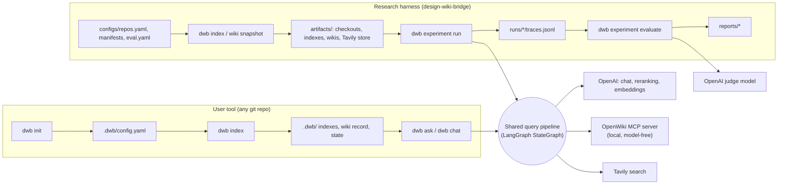
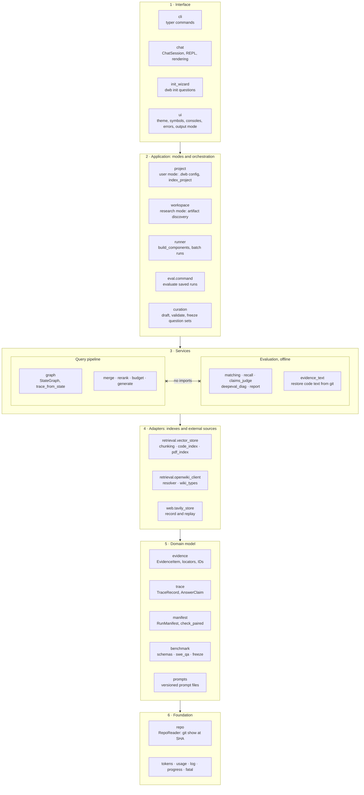
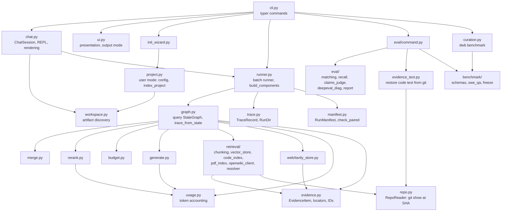
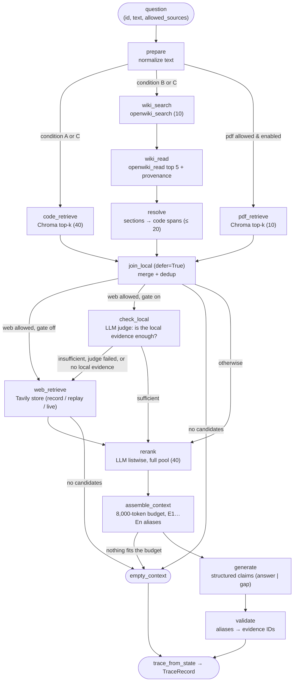
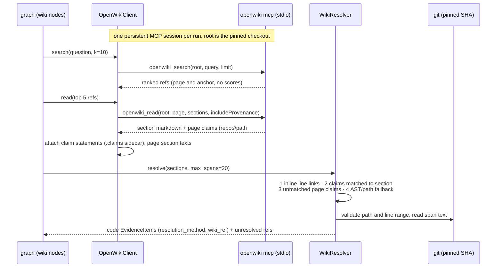
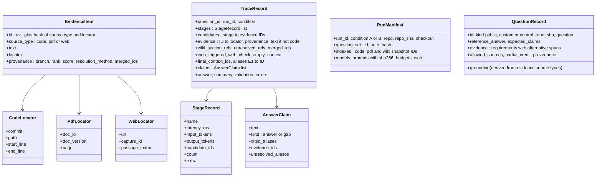
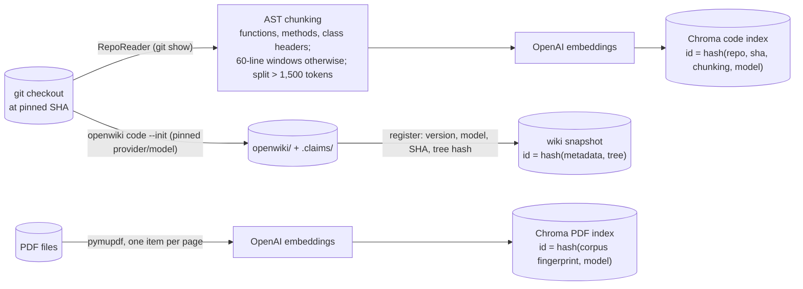
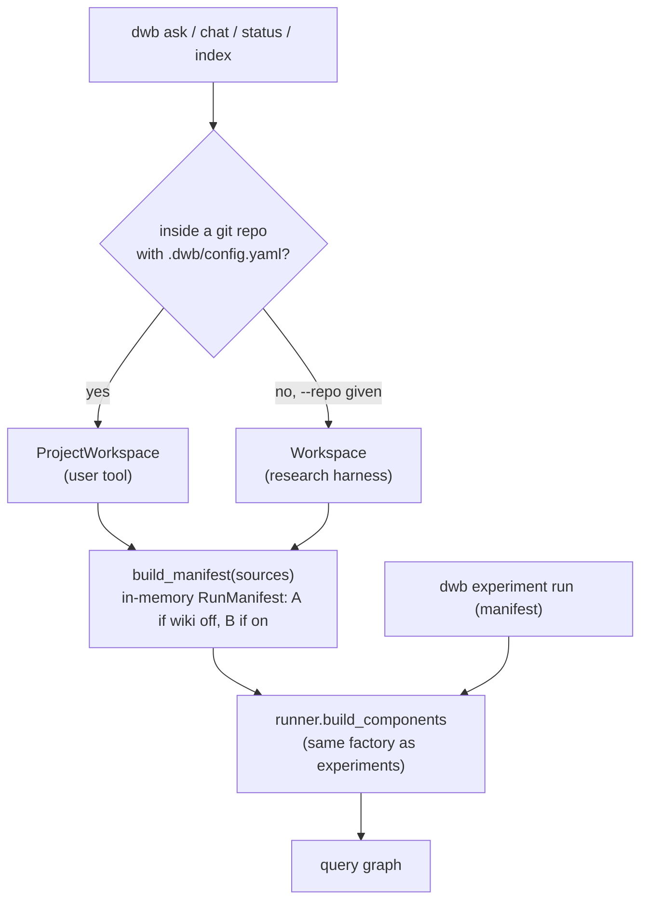
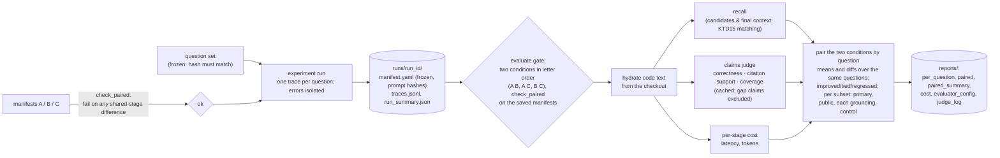

# dwb architecture

`dwb` answers questions about a software repository with citations to original evidence: code at a commit, PDF pages, and web passages. The same pipeline serves two purposes:

- a **user tool** you run inside any git repository (`dwb init` → `dwb index` → `dwb chat`);
- a **research harness** that compares ways of finding repository evidence, vector search (condition A), OpenWiki-guided search (condition B), and both together (condition C), on a frozen question set, with offline evaluation.

This document describes the components, how data flows through them, and the design decisions behind them. Usage is in [`usage.md`](usage.md), the study design in [`journal-extension-plan.md`](journal-extension-plan.md), the implementation plan in [`plans/`](plans/), and the empirical findings behind several decisions in [`spikes/2026-11-openwiki-swe-qa-spike.md`](spikes/2026-11-openwiki-swe-qa-spike.md) (cited below as *spike §n*). Conceptual figures for the paper are in [`paper-figures.md`](paper-figures.md).

## 1. System context

The repository is always a source. The wiki, PDFs, and the web are optional, and each is switched per run (research) or per question (user tool). Everything outside this diagram is local: git, Chroma, the PDF files, and the trace files.

## 2. Module view (layers)

The static structure of the `dwb` package: six layers, where a module may import only from its own layer or a lower one. The query pipeline and the evaluator share layer 3 but never import each other, so scoring cannot touch retrieval or generation. `tests/test_layers.py` enforces both rules and fails when a new module has no layer.

| Layer | Modules | Responsibility | External libraries |
|---|---|---|---|
| 1 Interface | `cli`, `chat`, `init_wizard`, `ui` | Parse commands and options, run the REPL, and render answers and logs. No retrieval logic. `ui` owns presentation: the theme and symbols (ASCII fallback), the stdout/stderr consoles resolved per invocation, the error/warning/outcome/header lines, the human-vs-JSON output switch, and the progress renderer (bars and spinners for `ProgressEvent`s on a colored terminal, one plain line per milestone otherwise). `cli` has the one exception boundary: expected errors print `✗`/`→` and exit 2, Ctrl-C prints `! Stopped` and exits 130, anything else prints a two-line summary, writes the traceback to `$XDG_CACHE_HOME/dwb/last-error.log`, and exits 1 | typer, rich, prompt_toolkit |
| 2 Application | `project`, `workspace`, `runner`, `eval.command`, `curation` | Choose the mode, find or build the artifacts, wire concrete components into the graph, run or score a question set, and curate question sets (draft, validate, freeze, check) | PyYAML, PyMuPDF (PDF page counts) |
| 3 Query pipeline | `graph`, `merge`, `rerank`, `budget`, `generate`, `sufficiency` | Answer one question: retrieve, merge, judge whether the local evidence suffices (the web gate), rerank, fit the token budget, generate cited claims. The pipeline depends on retriever interfaces; `runner` injects the concrete adapters | LangGraph, LangChain (`LLMListwiseRerank`, chat models) |
| 3 Evaluation | `eval.*` (except `command`), `evidence_text` | Score saved traces: span recall, claim correctness, citation support and coverage, cost tables | DeepEval (optional diagnostics), LangChain chat model (judge) |
| 4 Adapters | `retrieval.*`, `web.tavily_store` | Build and query the indexes, talk to OpenWiki over MCP and resolve wiki references to code spans, and record or replay Tavily | Chroma, OpenAI embeddings, langchain-mcp-adapters, tavily-python |
| 5 Domain model | `evidence`, `trace`, `manifest`, `prompts`, `benchmark.*` | The shared vocabulary: evidence items and IDs, traces, run manifests, question records, and prompt versions (see §6) | pydantic |
| 6 Foundation | `repo`, `tokens`, `usage`, `log`, `progress`, `fatal` | Read files at a commit through git, count tokens, collect usage from callbacks, and log. `fatal` tells provider errors no retry fixes (out of credit, a bad key) from ordinary ones. `progress` is the one event type (`ProgressEvent`) that indexing, the runner, OpenWiki generation and evaluation send to an optional `on_progress` callback; `ui` renders it, so no lower layer imports presentation code (KTD2). OpenWiki generation writes its own output to `.dwb/openwiki.log` so a spinner can show meanwhile; `-v` streams it to the terminal instead (KTD7) | tiktoken, LangChain callbacks, rich |

Two consequences of the layering:

- **Swapping a condition is a wiring change.** `graph` imports only the wiki result types from layer 4. `runner` decides which repository branches (A: vector, B: wiki, C: both) and which PDF and web adapters to build, so the shared stages are identical code in both conditions.
- **Both modes are thin.** The user tool (`project`) and the research harness (`workspace`, `runner`) differ only in layer 2. Both reach the same pipeline (§8).

## 3. Code map

The module-level detail behind §2: the main import edges between modules.

The evaluator (`eval/`) never imports the graph, the generator, the reranker, or the retrievers; a test enforces this. It reads only traces, question records, and git.

## 4. The query graph

One explicit LangGraph `StateGraph`, compiled per run or session for one condition: the vector branch (A), the wiki branch (B), or both in parallel (C):

- **Routing is deterministic, except the web gate.** Conditional edges read the manifest and the item's `allowed_sources`; no model decides which repository, PDF or downstream stages run. The one judged edge is web: with `web.conditional_web_search` on, the `check_local` verdict decides whether a web-eligible item searches the web (KTD7 as revised).
- **The local branches run in parallel.** List-valued state (`stages`, `repo_candidates`, `pdf_candidates`, `unresolved_refs`, `errors`, `warnings`) uses `Annotated[list, operator.add]` reducers. `join_local` is added with `defer=True`, so it runs once after every active branch has finished.
- **The web is a wider search after a narrow one.** Web runs only for items whose `allowed_sources` include `web`, when the manifest enables it, and is decided after the join, in one place, for every condition. With `web.conditional_web_search` on (the default), `check_local` first asks one LLM judge (the generator's pinned model, prompt `sufficiency_v1`, temperature 0) whether the merged local evidence can answer every part of the question. The judge reads the local pool interleaved by branch and cut to the context budget, without a rerank. Web runs when the verdict is insufficient, when there is no local evidence (no judge call), or when the judge fails (the question is then degraded). The verdict, its reason and the evidence IDs the judge saw go to the trace as `web_check`. With the flag off, web runs for every eligible item and no judge is called.
- **Record runs capture web for every eligible item.** In an experiment record run, `web_retrieve` also runs when the verdict is sufficient: it stores the Tavily response and adds nothing (stage `used: false`, `web_triggered` false), so a replay of either condition finds its web evidence whatever its own verdict. Capture-only calls are left out of latency and cost. Chat never captures this way. `experiment run --web-only` makes the same requests (the query is `graph.query_text`, the question text) without running the graph, so the test plan's record pass no longer needs a full run.
- **A failing source degrades the question; it does not fail it.** If code, wiki search, wiki read, resolve, PDF or web retrieval raises, that node records the error in its stage and adds a `warnings` entry, and the other branches still answer. A failed rerank call falls back to pool order the same way. Out of credit or a rejected key is the exception: `dwb.fatal` re-raises it from every catch-all, and the runner stops without saving the question in progress (`--resume` finishes the run later). Degraded questions are counted in the run summary and as the `degraded` metric. A Tavily replay miss is the exception: it fails the question, because a replay run must not answer without its frozen web evidence.
- **There is no fallback between repository branches.** If condition B finds nothing and no other source is enabled, the graph ends at `empty_context` rather than quietly switching to vector search. Condition C runs both branches by design, not as a fallback: their candidates meet in `join_local`, where a span both branches found is merged (the survivor records `also_from`), and the reranker's pool alternates between branches by in-branch rank. With the shared pool of 40, C sends up to 15 vector, 15 wiki and 10 PDF candidates when all three are full (A sends 30 vector and 10 PDF). The context budget is the same 8,000 tokens, so C does not get more context than A or B (KTD-B12).
- **Execution is `ainvoke`,** with no checkpointer and no streaming. Each node returns a `StageRecord` (latency, counts, tokens, stage-specific extras).

## 5. Condition B in detail

Wiki text never becomes evidence. It only guides discovery, and its section references are kept in the trace. Every span the resolver emits is original code at the pinned commit.

## 6. Data model

**Traces store code passages by reference.** Code passages carry no text in persisted traces: the text is exactly `git show <commit>:<path>` sliced to the lines, and `evidence_text.hydrate` restores it for evaluation. PDF and web text stay inline for the final context.

## 7. Build pipeline and artifacts

| | Research harness | User tool |
|---|---|---|
| Configuration | `configs/repos.yaml`, `configs/chat.yaml`, `configs/manifests/*.yaml`, `configs/eval.yaml` | `<repo>/.dwb/config.yaml` (written by `dwb init`) |
| Code | `artifacts/checkouts/<repo>-<tag>/` (shallow, single commit) | the repository itself, at HEAD |
| Indexes | `artifacts/indexes/<index_id>/` | `.dwb/index/<index_id>/` |
| Wiki | snapshot copied in `artifacts/wikis/<id>/`, restored into the checkout before a run | `openwiki/` used in place; record in `.dwb/wiki.json` |
| Web cache | `artifacts/tavily/<store_id>/` | `.dwb/tavily/chat-<name>/` |
| Run outputs | `runs/<run_id>/` (manifest, traces, summary), `reports/` | none (chat is not persisted) |
| Hidden from git | `.gitignore` (`artifacts/`, `runs/`, `reports/`) | `.git/info/exclude` (`/.dwb/`) |

Indexes are content-addressed. Building again with the same inputs reuses the existing index and never silently rebuilds it, and `dwb ask`/`chat`/`status` find indexes by repository, commit, and embedding model, so users never handle index IDs.

## 8. Two modes over one pipeline

`ask` and `chat` build an in-memory manifest from the source switches and run the same components and graph as `experiment run`. Answers in chat are therefore produced exactly as in the study. The workspace differs between the two modes only in where artifacts live and whether the wiki snapshot is restored (research) or used in place (user tool).

## 9. Research run and evaluation

Each report compares two conditions. Its paired columns are named after them (`mean_A`, `mean_C`, `mean_diff_C_minus_A`), so an A/B report keeps its original layout; the three comparisons are three reports over the same traces. Judge verdicts and DeepEval rows are cached, so scoring a run again in a second report makes no new calls. `per_question.csv` also carries `wiki_gold_coverage` for B and C: the share of the needed code the wiki route reached before reranking. For annotated questions (`wiki_gold_source` = `evidence_spans`) it is span-level: an evidence requirement counts when a wiki-resolved span matches any of its code alternatives under the evaluator's matching rules. For public questions (`reference_answer_files`) it is file-level, over the repository paths the reference answer names; reaching a large file is not reaching the function, so only a 0 is conclusive there. A 0 is a wiki coverage gap, which ranking and generation cannot recover; `report_summary.json` counts them per condition and source.

## 10. Main design decisions

IDs refer to the implementation plan (KTD) or the spike document (§).

| # | Decision | Rationale | Rejected alternatives |
|---|---|---|---|
| 1 | **Explicit `StateGraph` with deterministic routing** (KTD11) | The conditions must be controlled and comparable; an agent choosing tools would add an uncontrolled variable. The web gate (decision 11) is the one LLM-judged edge: one fixed judge, prompt and budget shared by both conditions, deciding only whether to widen the search | Deep Agents, LLM routing |
| 2 | **Interchangeable repository branches; everything downstream shared** (R4, R6) | Isolates the effect of how repository evidence is found. `check_paired` fails any pair of conditions that differs in a shared stage, or (A/C, B/C) in the code index or wiki snapshot they share | Per-condition tuning |
| 3 | **Deterministic evidence IDs plus per-prompt aliases** (KTD1) | The same span gets the same ID across runs and conditions, which makes recall comparable. Short `E1…En` aliases keep prompts small and give validation a closed set | Random IDs, citing paths inline |
| 4 | **Wiki guides discovery, never evidence** (R3) | Answers must cite original code; generated text is not ground truth | Citing wiki sections |
| 5 | **OpenWiki through its native MCP search/read, one persistent session** (KTD2) | Keeps "native OpenWiki retrieval" true with the least glue. The server is local and model-free | Reading wiki files directly; a new server per call |
| 6 | **Resolver order: inline links → section-matched claims → page claims → AST/path** (KTD4 revised, spike §6) | OpenWiki claims are page-level. Matching claim statements to sections attributes 75% of them cleanly, and line links are exact but rare | All page claims for every section; claims only for whole-page reads |
| 7 | **Chroma + OpenAI embeddings, AST chunking** (KTD5) | The smallest install, and chunks align with code units. Indexes are content-addressed and reused | FAISS with local embeddings; the unavailable conference stack |
| 8 | **LLM listwise reranker, wrapped** (KTD3) | The user's choice. The wrapper ranks the full pool, repairs dropped or duplicated positions, logs usage, and keeps IDs | Cross-encoder (deferred) |
| 9 | **The context is sized by tokens, not by count** (spike §9–10) | With count-based `top_n`, B's larger spans gave its generator 1.3–4× more text. `top_n` = pool = 40 and A's `code_top_k` = 40 make the 8,000-token budget binding in both conditions | Count-based `top_n` = 12 |
| 10 | **Structured claims with an explicit `gap` kind** (KTD9, prompt v2) | Claim boundaries come for free for the evaluator, and abstention is separated from hallucination (gap claims are excluded from support and coverage and reported as `abstained`/`gap_claims`) | Inline `[E1]` citations in prose; treating refusals as uncited claims |
| 11 | **Web is declared per item, gated on insufficient local evidence, and the project's own sites are excluded** (KTD7 as revised by the conditional-web-search plan, spike §8) | The same judge, prompt and evidence budget apply in both conditions, so the rule stays identical by construction even when the verdicts differ; the report splits gated questions by A/B verdict agreement. The project's docs restate unpinned code behavior and would let either condition answer without finding code | Score thresholds (not comparable between the vector and wiki branches); web whenever allowed (still available: `conditional_web_search: false`); allowing project docs |
| 12 | **Tavily record/replay store keyed by the normalized request** (KTD8) | The paired comparison needs identical web evidence; a replay miss is an error, never a silent live call. Only `search` and `extract` are used, never `research()` | Live calls per run |
| 13 | **Manifest-driven runs, frozen copies, file-based traces** (KTD13, R10) | Every run can be reproduced from its directory: models, prompt hashes, budgets, index and snapshot IDs, question-set hash | A database; implicit configuration |
| 14 | **Evaluation is a separate offline command** (R13) | Scoring never influences generation. A static import check enforces the separation, and judge verdicts are cached | Inline evaluation; DeepEval tracing or Confident AI |
| 15 | **Code text by reference in traces** | Lossless (re-read from git at the pinned SHA, verified identical) and about 25% smaller | Inline text; gzip |
| 16 | **Pinned, separate judge model** (KTD10, KTD16) | Lowers self-preference bias; dated snapshot for reproducibility | Using the generator as judge |
| 17 | **One pipeline, two modes** | The user tool and the study share every component, so what users see is what the study measures; modes differ only in workspace and artifact location | A separate chat implementation |
| 18 | **User mode indexes the HEAD commit through git, keeps everything in `.dwb/`** | Citations point at a real commit; uncommitted edits are excluded with a warning, and a stale index is flagged. Nothing is written to the repository's `.gitignore` | Indexing the working tree |
| 19 | **Token accounting from LangChain callbacks, approximate counts as fallback** | Provider usage where available; LangChain's `count_tokens_approximately` for embeddings (no callbacks) or missing usage, labelled as approximate. The context budget keeps an exact counter because it is a pipeline rule | tiktoken everywhere; no embedding accounting |
| 20 | **Failures count against the condition; degraded answers are flagged** (code review 2026-11-17) | A failed question scores correctness 0 (no answer) instead of dropping out of one side's mean, which would favor the condition that fails more. Its cost is left empty, not 0. A source or rerank failure keeps the answer but marks it `degraded`. Means are taken over the questions scored on both sides | Excluding failures silently; failing the whole question when one source fails |
| 21 | **`evaluate` rechecks the pair** (code review 2026-11-17) | The saved manifests must be two conditions in letter order (A B, A C, B C) and pass `check_paired`, so a swapped or mismatched pair cannot produce a valid-looking report. `--allow-unpaired` overrides it and is recorded in `evaluator_config.json`. Judge verdicts are cached per judge model and temperature | Trusting the argument order |
| 22 | **Indexes must match the manifest they are used with** (code review 2026-11-17) | Condition A's index must be cut with the manifest's `max_span_tokens` and the current `chunker_version`; the runner refuses otherwise. User mode uses only the IDs `dwb index` recorded in `state.json`, and refuses a wiki that changed since | Picking the newest matching index |
| 23 | **One presentation module and one exception boundary** (CLI UX plan KTD1, KTD5, KTD6) | `dwb.ui` resolves consoles and the output mode when output is written (`CliRunner` swaps streams per call), so `NO_COLOR`, `--no-color`, `--json` and TTY detection hold per invocation. The boundary is a custom Typer group, so tests exercise it; Click's own exits pass through untouched | Per-command `except` blocks; a boundary in `main()` that tests never reach |
| 24 | **Condition C runs both repository branches into the shared reranker** (KTD-B12, after the dev pilot) | The pilot showed B fails when the wiki does not cite the code a question names, while A finds it. C asks whether the wiki adds anything on top of vector search, which is how a wiki would be used in practice. The branches compete in the same pool and context budget, so C gets no extra context | A code-lookup fallback inside B (changes what B measures); a larger budget for C
| 25 | **An exhausted account stops a run; `--resume` finishes it** (KTD-B13) | Without it, running out of credit would fail every remaining question (each scored 0) and could leave reranker fallbacks in traces that look degraded rather than broken. The run stops before saving the interrupted question; `--resume` checks that the saved manifest is identical and runs only the questions without a trace, keeping failed ones (rerunning failures stays a manual, all-condition step). Ordinary rate limits are still retried by the clients. |

## 11. Invariants

- Evidence item = ID + source type + text + locator, and IDs survive merge, reranking, context assembly, and generation. Validation logs every cited alias that doesn't resolve.
- Shared stages are identical across conditions (`dwb experiment check`).
- The web runs only when the manifest enables it and the item allows it. Public SWE-QA items never allow it.
- If one branch returns nothing, the others still contribute. When nothing is found at all, the graph records an explicit empty context and never substitutes another retriever.
- The test set is frozen by content hash. Development questions are separate, and the runner rejects any ID or question text shared between dev and test.
- Nothing leaves the machine except calls to OpenAI, Tavily (only when the web is enabled), and OpenWiki generation (only when requested). Telemetry is off for OpenWiki and Chroma.
- In user mode, API keys are per project: they come only from `<repo>/.dwb/.env` (or the shell), and only `OPENAI_API_KEY` and `TAVILY_API_KEY` are read from it, so a cloned repository cannot set `OPENAI_BASE_URL` and redirect the key. Neither the repository's own `.env` nor `~/.config/dwb/.env` is read; the latter is used only in research mode. OpenWiki 0.9.0's file tools list hidden folders and honor only `.openwikiignore`, not git's ignore rules, so `init` and every wiki generation make sure `.openwikiignore` lists `/.dwb/`.
- Every network or subprocess call has a timeout: OpenAI clients (180 s, 2 retries), OpenWiki MCP calls (120 s), git (120 s), PDF downloads (60 s).

## 12. Known limitations and parked work

- **Run-to-run variance** from generation and judging is visible even at temperature 0 (spike §10). Report it as a validity threat, or measure it with repeated dev runs.
- **Condition B depends on wiki coverage and on lexical wiki search** over the raw question (spike §9). The query rule is frozen and not tuned. In the dev pilot (2026-11-22) every B answer that scored 0 asked about a symbol the wiki never cites (`morsel_to_cookie`, `get_encodings_from_content`, the `TestUrlFor` tests); `wiki_gold_coverage` measures this on the test set, and condition C measures what vector search recovers.
- **`gpt-5.6-luna` has no dated snapshot ID**, so the model behind the name could change during the study.
- **A question that fails mid-graph keeps only its error,** not the stages that already ran (`ainvoke`, no streaming). Source failures no longer fail the question (see §4), so this now covers only generation-stage and replay-miss failures.
- **Chunker version 2 (2026-11-17) changes condition A's indexes.** Class-body lines after the first method are now indexed, and lines are split on `\n` only. Indexes built before have `chunker_version` 1 and must be rebuilt; their IDs change, so the A manifests need the new IDs.
- **Parked:** an organic telemetry refactor (one callback handler per question attributed via LangGraph node metadata, separate telemetry records, pluggable sinks); see `docs/plans/2026-11-17-1830-refactor-organic-telemetry-plan.md` on `main`. Also deferred: a cross-encoder reranker backend, a matched-budget control run, and PDF-text-by-reference in traces.
