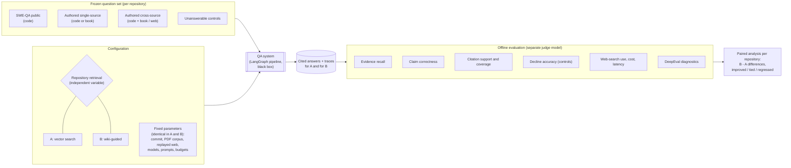

# Question Sets and Evaluation Protocol

Status as of 2026-11-22. This document describes where the question sets stand today and how the paper's experiment will be run and scored. The implementation plan is `docs/plans/2026-11-22-1050-feat-authored-benchmark-experiment-plan.md`; this document is the readable summary of it.

## 1. The experiment in one paragraph

Two conditions answer the same questions about two pinned repositories, Flask 3.1.2 and Requests 2.32.5. **Condition A** finds repository evidence by vector search over the code. **Condition B** finds it by following the generated OpenWiki pages to the code they describe. Everything else is shared: the PDF retriever, web search (Tavily, with replayed results), the sufficiency judge that decides whether to search the web, the reranker, the context budget, the generator and the citation format. Each question is answered once per condition, and the answers are scored offline from the saved traces.

## 1a. Experimental setup (as it will be described in the paper)

**Design.** A paired, within-question comparison of two configurations of one question-answering system. The system (a LangGraph pipeline) is treated as a configurable black box. It takes a question and a configuration, and returns a cited answer plus a trace of the evidence it used. Every question is answered under both configurations, so each question serves as its own control.

**System under test.**
- **Inputs:** the question text and the question's allowed source types (code, PDF, web).
- **Configuration:** the repository commit, the PDF corpus, the web policy and replayed web results, the models and prompts, and the retrieval and context budgets.
- **Outputs:** an answer made of claims that cite evidence items (code spans, PDF pages, web passages), and a trace recording the retrieved candidates, the final context, the citations, cost and latency.

**Independent variable.** One configuration parameter, the repository-retrieval mode:
- **A (baseline):** repository evidence found by vector search over the code.
- **B (wiki-guided):** repository evidence found through generated OpenWiki pages, resolved to code at the same commit. Wiki text is not cited.

**Controlled variables.** Every other configuration parameter is identical in A and B. A paired configuration check (`dwb experiment check`) verifies this before any run.

**Subjects.** Two Python libraries with public SWE-QA splits and links to external specifications: Flask 3.1.2 (with three Flask books as PDF sources) and Requests 2.32.5 (with web sources only).

**Questions.** About 30 per Flask and 19 per Requests, in four groups:
- SWE-QA public questions (code-only);
- authored single-source questions (code or book);
- authored cross-source questions (code with a book or a web page);
- unanswerable controls.

Authored questions carry expected claims and annotated evidence spans. The set is frozen and hashed before any run.

**Dependent measures.** Computed only from the system's outputs and traces:
- **Primary:**
  - evidence recall at the candidate and final-context stages;
  - required-claim correctness;
  - citation support and coverage;
  - decline accuracy on controls;
  - web-search use;
  - cost and latency.
- **Diagnostic:** DeepEval Contextual Recall and Faithfulness.

**Procedure.**
1. A pilot on separate development questions.
2. A record pass that stores all web results.
3. The paired runs of configurations A and B, both replaying the same stored web evidence.
4. Offline scoring of the saved outputs by a judge model different from the system's generator.

**Analysis.** For each repository: paired B − A differences, with improved, tied and regressed counts, over the questions that need code evidence. Groups under about 10 questions, book-only questions and controls are reported descriptively. A co-author independently checks a stratified sample of judgments.

## 2. Question sets today

| File | Contents | Status |
|---|---|---|
| `data/questions/cross_source_benchmark.md` | 25 authored questions: 20 answerable, 5 unanswerable controls. Written against RFC PDFs, one Flask book, the project paper and one Requests docs page | Source text only; not loadable by the harness; untracked |
| `tests/eval/.dataset.json` | The same 25 questions as a DeepEval dataset, plus 10 variants generated with `deepeval generate` | Provenance record only; nothing reads it; untracked |
| `data/questions/dev/flask.jsonl`, `dev/requests.jsonl` | Per repository: 1 SWE-QA public question and 2 AI-drafted custom questions that cite RFC PDFs | Used by the earlier pipeline runs (`runs/*-dev-001`) |
| `data/questions/test/` | Empty | The frozen test set will go here |
| `data/questions/selections/` | Empty | SWE-QA row selections will go here |
| `data/questions/drafts/web-items.draft.md` | 10 code+web questions drafted by Claude: 4 re-sourced Requests items, 3 new per repository | Needs your review |
| `data/questions/drafts/flask-book-resourcing.draft.md` | Book evidence for Flask's RFC-based items, plus 4 new code+book questions (N1–N4) | Needs your review |

### Why the authored benchmark needs work before it can run

- **Format.** The harness's question format requires every authored question to cite code plus an external source. Only 11 of the 25 do. It has no type for unanswerable controls, and no question names a repository.
- **Corpus change.** The evaluation PDFs for Flask are now the three Flask books, not the RFCs used during testing. Requests gets no PDFs; it uses web pages instead. Ten questions cited RFCs, so they need new sources.
- **Web rule.** Question 19 cited `requests.readthedocs.io`, which the experiment excludes: a project's own docs restate the code and would let either condition answer without finding it.
- **Old books.** The books describe Flask 0.12.2 (Grinberg) and 0.10.1 (Aggarwal). Answers must hold for Flask 3.1.2, so book claims that are out of date are excluded from expected answers. Aronowitz states no version and supports no question.

## 3. The test set that will be frozen

Per repository: the re-sourced authored questions, plus 8–10 SWE-QA public questions drawn at random (with a recorded seed) from the eligible rows.

### Flask (about 29–31 questions)

| Group | Questions | Evidence | Status |
|---|---|---|---|
| Code-only | 1–6 | Flask code | Ready to convert |
| Book-only | 12′ (request object, rewritten), 13 (contexts) | Grinberg pages | 13 ready; 12′ needs review |
| Code + book | 14′ (automatic OPTIONS), 15′ (static-file route), 17′ (WSGI middleware), N1–N4 (new) | Flask code + Grinberg or Aggarwal | Drafted; needs review |
| Code + web | 3 new (session-cookie attributes, `Vary: Cookie`, OPTIONS and `Allow`) | Flask code + MDN / rfc-editor.org | Drafted; needs review. The OPTIONS one overlaps 14′; keep one |
| Controls | 21, 23, 25 | none (expected: decline) | Ready to convert |
| SWE-QA public | 8–10 | Flask code | To be selected |

### Requests (about 18–20 questions)

| Group | Questions | Evidence | Status |
|---|---|---|---|
| Code-only | 7 | Requests code | Ready to convert |
| Code + web | 10′, 16′, 18′, 19′ (re-sourced from RFC PDFs and the docs page), 3 new (fragments on redirect, body framing, auth headers on redirect) | Requests code + rfc-editor.org / MDN | Drafted; needs review |
| Controls | 22, 24 | none (expected: decline) | Ready to convert |
| SWE-QA public | 8–10 | Requests code | To be selected |

### Removed from the test set

- **Items 8, 9, 11** (safe and idempotent methods, CGI variables): no book covers them.
- **Item 20** (the project paper): the paper is in no corpus, and the question cannot distinguish A from B.

### Development set (for the pilot)

- The existing SWE-QA development question per repository.
- The four RFC-based development questions, re-sourced to the new corpus policy.
- The generated variants whose parent question survives, re-sourced like their parents. They reword test questions, so they serve only as a harness smoke test. Prompt or configuration changes may only come from failures on the other development questions. Each variant is listed against its parent for disclosure.

### Rules for every test question

- **Human review.** Questions drafted by Claude are reviewed and edited by you, and their provenance records it. The paper discloses that drafting happened after the wikis were generated. Drafting and review must not look at the wikis or any condition's traces.
- **Allowed sources.** Authored answerable questions may use every local source their repository has (Flask: code and PDFs; Requests: code). Only code+web questions also allow web. Controls never allow web. SWE-QA questions are code-only.
- **Retrievable web evidence.** Before freezing, each web question is sent to Tavily exactly as the system will send it, and must return a page that matches its gold evidence (`dwb benchmark webcheck`). Questions that fail get acceptable alternative pages, are reworded or are dropped. The paper discloses this filtering.
- **Validated and frozen.** `dwb benchmark validate` checks every code line range and PDF page against the pinned sources. `dwb benchmark freeze` records a hash that each run manifest must match. `dwb benchmark check` confirms development and test sets share no question.

## 4. Sources

| | Flask | Requests |
|---|---|---|
| Repository | `artifacts/checkouts/flask-3.1.2` at `2c1b30d0` | `artifacts/checkouts/requests-v2.32.5` at `b25c87d7` |
| PDFs | Grinberg, Aggarwal and Aronowitz books (new index) | none |
| Wiki (condition B) | pinned OpenWiki snapshot | pinned OpenWiki snapshot |
| Web | Tavily, replayed; excludes flask.palletsprojects.com, werkzeug.palletsprojects.com, github.com, pypi.org | Tavily, replayed; excludes requests.readthedocs.io, docs.python-requests.org, github.com, pypi.org |

## 5. How a question is answered

1. Repository search (A or B) and, where allowed, PDF search run in parallel and are merged.
2. If the question allows web, the sufficiency judge decides whether the local evidence answers every part of the question. Web is searched only if it does not, if there is no local evidence, or if the judge fails.
3. The reranker orders the evidence, the context is cut to 8,000 tokens, and the generator answers as cited claims. A claim the evidence does not support is written as "not established by the evidence".

## 6. How the experiment is run

1. **Pilot** on the development set, A and B per repository, to check the pipeline end to end.
2. **Record pass** per repository: Tavily is called live and every web result is stored, including for questions whose judge says the local evidence is enough. `web_capture_failed` must be 0.
3. **Paired runs**: condition A and condition B on the frozen test set, both replaying the stored web results, so both see identical web evidence.
4. **Failures** are scored as 0. A question is rerun only for an infrastructure fault (provider outage, timeout), and then in both conditions, with the cause logged.

## 7. How answers are scored

All scoring runs afterwards, with `dwb experiment evaluate runs/<A> runs/<B> --out reports/<name> --deepeval`, from the saved traces. The judge model (`gpt-5.5-2026-04-23`) differs from the generator.

### Primary metrics

| Metric | What it measures | Applies to |
|---|---|---|
| Evidence recall (candidates, final context) | Did the system retrieve the annotated evidence spans? | Answerable questions with annotated evidence |
| Claim correctness | Share of the required claims the answer states correctly | Answerable questions |
| Citation support and coverage | Are the answer's claims supported by the evidence they cite, and is every claim cited? | Answerable questions |
| Decline accuracy (`control_correct`) | Did the system decline (all claims "not established")? | Controls only |
| Web gate | How often each condition searched the web; agreement between A and B | Web-eligible questions |
| Cost and latency | Tokens and time per question, including the judge | All |

### Primary comparison

Fixed before the runs. Per repository, the paired A − B differences, plus improved, tied and regressed counts, over the questions that need code evidence: SWE-QA, code-only, code+book and code+web. Book-only questions and controls are sanity checks, expected to show no A/B difference. Any group with fewer than about 10 questions is reported as counts, without comparative claims.

### DeepEval diagnostics (secondary)

DeepEval runs as a library over the same saved traces. There is no tracing, no Confident AI and no generated data. For each question and condition it receives the question, the answer as shown to the user, the text of the passages that reached the generator, and the reference answer.

| Question type | Contextual Recall | Faithfulness |
|---|---|---|
| Answerable (all types) | Runs: did the final context contain what the reference needs? | Runs: is everything the answer states supported by that context? |
| Control | Skipped: the reference is a decline | Runs: catches answers made up despite missing evidence |
| No answer or no context | Skipped, with the reason recorded | Skipped |
| Failed question | No row (already scored 0) | No row |

Results go to `deepeval_diagnostics.csv` per question, and to a summary per question type and condition, with each metric's cost. DeepEval does not pin its own temperature, so these scores can vary between runs; they are reported as diagnostics next to the primary metrics, never instead of them.

## 8. What happens next, and who does it

| Step | Who |
|---|---|
| Extend the question format (control type, single-source questions), evaluation changes, corpus and manifests, `webcheck` command | Claude (implementation) |
| Review the drafts in `data/questions/drafts/` and approve or edit each question | You |
| Approve the SWE-QA random sample | You |
| Convert accepted questions, run the web check, validate and freeze | Claude, with your sign-off on any question changed |
| Pilot, record pass, paired runs, evaluation | Claude (model and Tavily cost) |
| Independent check of a stratified sample by a second reviewer | A co-author, after freezing |
| Update the journal plan's test-set section and the paper's method text | Claude drafts, you edit |
