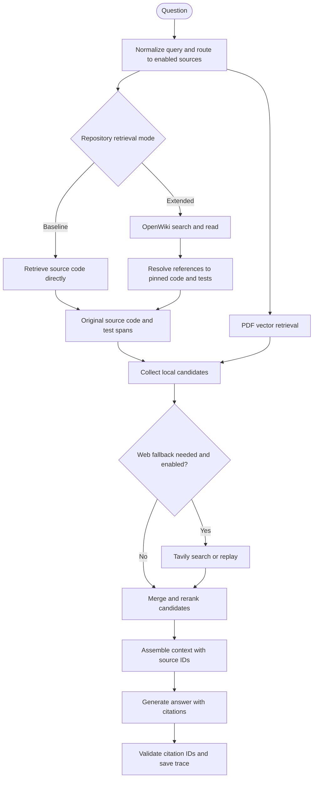

# CIBSE journal extension plan

**Target milestone:** first week of December 2026  
**Scope:** LangGraph, one wiki generator (LangChain OpenWiki), two SWE-QA repositories, Tavily for Web evidence, and DeepEval for offline scoring. Jev is deferred.

## Contribution and research questions

The conference paper combined repository, PDF, and Web retrieval and evaluated 27 questions on one project. Its results highlighted weaker attribution on combined-source questions. The journal extension uses generated wiki sections to discover original code and test evidence, then tests whether this improves cross-source answers and their citations.

1. **Evidence retrieval.** Does OpenWiki guidance improve recall of original evidence for repository and cross-source questions?
2. **Answer quality.** Does it improve required-claim correctness and the support and coverage of citations?
3. **Efficiency.** What are the per-query costs in context tokens, latency, and model usage, and what does generating the wiki cost up front?

## Repository and benchmark selection

Start directly with [SWE-QA](https://huggingface.co/datasets/swe-qa/SWE-QA-Benchmark). Use **Flask and Requests** provisionally. Both have public question splits and offer candidate links to external specifications: WSGI for Flask and HTTP semantics for Requests. Keep pytest as a reserve if a candidate fails the revision or wiki integration check.

- Before committing to a repository, check five SWE-QA items against a candidate SHA. Confirm that the reference answers and named symbols match the checkout, that the wiki generates, and that one cross-file question can be traced to original evidence. Record the revision-selection rationale and any mismatches.
- Select **12–15 public questions per repository** using prespecified criteria that favor cross-file behavior, with some local questions for comparison. Retain the upstream split and row identifier, and record exclusions or edits.
- Author **6–8 cross-source questions per repository** from original artifacts before consulting generated wiki coverage. Require independently checkable claims from both code or tests and an external specification, documentation page, or PDF. Examples include tracing Flask's WSGI application entry into request handling and comparing an HTTP redirect rule with Requests' implementation and tests.
- Target **36–46 evaluation questions** across two repositories. Treat the original 27 conference questions as optional migration checks. A handful can help diagnose a port discrepancy if the original materials are readily available.
- **As frozen (2026-11-22; see `docs/benchmark-and-evaluation.md` and `docs/plans/2026-11-22-1050-feat-authored-benchmark-experiment-plan.md`):** the selection above was revised to 10 SWE-QA public questions per repository (seeded sample) plus the authored cross-source benchmark, re-sourced so Flask's PDF corpus is three Flask books and Requests' external material is RFC web pages, plus unanswerable controls. Flask: 30 questions (10 public, 17 authored, 3 controls); Requests: 20 (10 public, 8 authored, 2 controls). Authored questions may be single-source; the primary A/B comparison covers public questions and authored questions that need code. Agent-drafted questions were human-reviewed, and drafting happened after the wikis were generated (disclosed).
- For each custom item record the question, repository SHA, expected claims, acceptable evidence spans and alternatives, required source types, and partial-credit rules. For public items record a revision-verified reference answer and annotate spans on a manageable subset. Have a second reviewer independently check a stratified sample and resolve disagreements before freezing the test set. Use separate development questions for tuning.

## Implementation

### 1. Port the conference workflow

Build a baseline LangGraph workflow for question preparation, code and PDF retrieval, Web retrieval or fallback, reranking, context assembly, and answer generation. Preserve recoverable conference settings. Document model, provider, or routing substitutions and call the result conference-equivalent only to the extent the configuration supports that description.

Represent each evidence item with an ID, source type, text, and locator. Use commit/path/line range for code, document version/page for PDFs, and URL/capture ID/passage for Web material. Require the generator to cite evidence IDs. Record unresolved IDs during validation.

Add a batch runner driven by a configuration manifest. Persist the repository SHA, document and wiki snapshots, models and prompts, retrieval limits, candidate lists, final context, answer, citations, timing, failures, and usage. Keep evaluation as a separate command over saved outputs.

### 2. Add OpenWiki-guided evidence retrieval

Generate and pin one [OpenWiki](https://github.com/langchain-ai/openwiki) snapshot per checkout. Record generator version, configuration, and generation cost and elapsed time. Call native MCP search and read from LangGraph using a fixed shortlist budget. Capture ranked section references and selected full sections.

Resolve source links and file or symbol references to code or test spans at the same commit. Log unresolved references. Merge resolved spans with candidates from the enabled PDF and Web branches, deduplicate by source locator, and apply the same reranker and final context budget. For the pilot, inspect a complete trace from question to wiki hit to original span to cited answer claim.

### 3. Integrate Tavily

Use Tavily for Web discovery and save the exact requests and returned passages with source URLs and capture dates. Use the same frozen Web evidence pool for each question in the paired quality comparison. Apply the same Web fallback rule in both configurations. Measure live Tavily latency separately if needed. Keep public repository-QA cases scoped to repository evidence in both conditions to avoid retrieving published benchmark answers from the Web.

### 4. Compare repository retrieval methods

| Condition | Repository retrieval |
|---|---|
| A. Langflow-style baseline in LangGraph | Retrieve top-k source code spans directly from the pinned repository using its code vector index. The conference Langflow export isn't available, so this baseline makes no claim of conference equivalence. |
| B. OpenWiki in LangGraph | Call OpenWiki search and read, then resolve selected sections' references to original code or test spans. |

Both configurations share the PDF retriever, Tavily policy, LLM listwise reranker (LangChain `LLMListwiseRerank`, pinned model, temperature 0), context budget, generator, and citation format. Run both on the same questions. Match the repository candidate budgets where practical and log the number returned by each branch. Condition B reads original code only when resolving a reference discovered through OpenWiki.

## LangGraph design

The query graph follows Figures 2 and 3 of the conference paper. It normalizes the question, routes it to the enabled sources, reranks the results, and builds a grounded answer. The repository branch has two implementations. The experiment configuration selects one per run.

- **Offline preparation.** Ingest PDFs into the shared vector index. For condition A, index repository chunks. For condition B, build and pin the OpenWiki snapshot from the same commit used for source resolution.
- **Conditional tool calls.** OpenWiki search returns ranked wiki section references. Read the selected sections, resolve their source references, and return code or test spans in the same evidence format as direct retrieval. The graph records wiki section IDs and unresolved references. If wiki retrieval yields nothing, the other enabled branches still contribute evidence.
- **Shared downstream stages.** Wait for the enabled local branches before evaluating Web fallback. The fallback policy is declared per item: Web runs only when the run enables it and the item's allowed sources include Web. Apply the same fallback policy in both conditions and use frozen Tavily passages when invoked during the quality study. Log whether each condition triggered fallback. Keep Web disabled for public repository-QA items.
- **Citations and evaluation.** Preserve evidence IDs through reranking and generation. Cite original repository spans, PDF pages, or Web passages. Keep wiki references in the trace to explain how source evidence was found. Run DeepEval separately on saved traces.

## Evaluation and analysis

- **Evidence recall:** check annotated spans at candidate retrieval and again in final context. Specify how span matching and alternative evidence are handled.
- **Required-claim correctness:** score the custom items against claim rubrics. Score public items against their verified reference answers.
- **Citation support and coverage:** resolve IDs deterministically. Judge each material claim against its cited passages, allowing passages to support a claim jointly. Report support for cited claims and the share of material claims with supporting citations.
- **Cost:** report per-stage latency, context tokens, and available model costs. Separate wiki generation from per-query costs and cached Web runs from live calls.

Run [DeepEval](https://deepeval.com/docs/evaluation-end-to-end-single-turn) offline on saved traces. Use contextual recall and faithfulness for diagnostics and a custom claim-and-cited-span evaluator for attribution. Audit a stratified sample of both conditions with condition labels hidden where practical. Record evaluator configuration and disagreements. Report paired differences and improved/tied/regressed counts separately for public and custom questions. Inspect failures involving wiki ranking, missing or stale references, reranking, and incorrect synthesis. Limit generalization to the two studied repositories.

## Journal paper outline

Conceptual figures with draft captions (overview, wiki-guided discovery, study design) are in [`paper-figures.md`](paper-figures.md).

| Section | Planned content |
|---|---|
| Introduction | Use the conference attribution gap to motivate verifiable answers that connect concepts to implementation. State the method, benchmark and empirical contributions. |
| Related work | Cover repository QA, generated repository documentation, and citation-grounded retrieval. Explain how the cross-source questions complement SWE-QA. |
| Method | Summarize the baseline and describe wiki search, section reads, span resolution, and citation assembly. Show a worked example from question to original sources. |
| Benchmark and study design | Document project and revision selection, SWE-QA sampling, question authorship, annotation, paired conditions, scoring and calibration. |
| Results | Present evidence recall, claim correctness, attribution, and cost by subset. Include paired differences and representative failures. |
| Discussion and validity | Address benchmark familiarity, revision alignment, wiki coverage, the candidate-budget control, Web replay, judge agreement, and limited project diversity. |
| Artifact and conclusion | Provide manifests, question records and evidence annotations where redistribution permits, run and scoring scripts, and example traces. State the observed benefits and costs. |

Maintain a conference-to-journal change table for submission. The substantive new material is wiki-guided discovery of original evidence, the SWE-QA extension with cross-source claim annotations, and the controlled two-repository evaluation. Check the target journal's extension requirements when preparing the submission.

## Schedule

| Window | Implementation and evaluation | Writing |
|---|---|---|
| Nov 15–21 | Verify sample SWE-QA items and revisions. Generate one wiki, port the baseline, and trace the first complete answer. | Draft the problem, contributions, and RQs. |
| Nov 22–28 | Finish both wiki snapshots, Tavily replay, and annotation. Pilot and freeze the benchmark, configurations, and scoring. | Draft method, example, benchmark, and study protocol. |
| Nov 29–Dec 5 | Run paired conditions, audit grades, inspect regressions, and regenerate tables. | Write results, validity, artifact description, and extension statement. |

If time tightens, reduce the number of public items and skip the optional migration replay and matched-budget control. Preserve both repositories, the paired configurations, and the custom evidence annotations.
