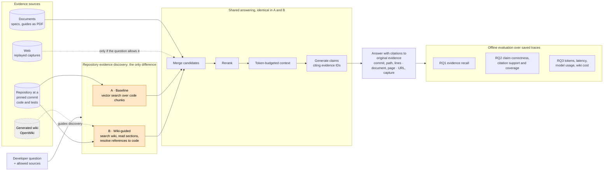
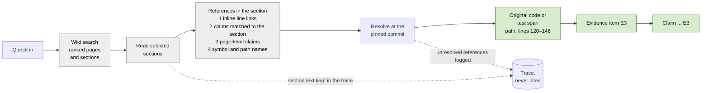
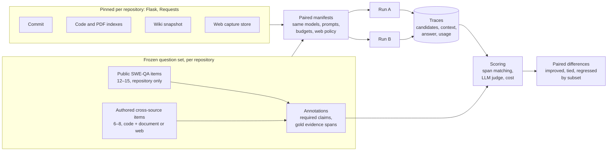

# Paper figures

Conceptual diagrams for the journal paper, drawn at the level of the method rather than the code. They were drafted before condition C (both routes) was added and before the test set was frozen: the paper also compares C, and the frozen sets have 10 public and 8–17 authored questions per repository (`benchmark-and-evaluation.md`). Figure 1 suits the introduction or the start of the method section, Figure 2 the method section (wiki search, section reads, span resolution, and citation assembly), and Figure 3 the benchmark and study design section. The implementation view is in [`architecture.md`](architecture.md).

Each figure is mermaid with a draft caption. To export a vector figure, paste the block into [mermaid.live](https://mermaid.live) and download SVG, or run `mmdc -i fig.mmd -o fig.pdf` with the mermaid CLI. The colors are placeholders. Redraw in the journal's style if needed, keeping the same elements.

## Figure 1. Conceptual overview

**Caption (draft).** Overview of the approach. A question is answered from original evidence: code and tests at a pinned commit, documents, and, when the question allows it, replayed web passages. The two conditions differ only in how repository evidence is discovered: vector search over code chunks (A) or wiki-guided discovery (B), where the generated wiki is used to navigate but is never cited. All later stages are shared, and evaluation runs offline over saved traces for the three research questions.

## Figure 2. Wiki-guided discovery: the wiki points, the code proves

**Caption (draft).** Wiki-guided discovery in condition B. Wiki search and section reads (grey) only locate candidate code: references are resolved in a fixed order, from exact line links to symbol and path names, into spans of the original files at the evaluated commit (green). The generator cites those spans, never wiki text, so citations in both conditions point to the same kind of evidence and are checked the same way.

## Figure 3. Study design

**Caption (draft).** Study design. For each repository, a frozen set of public and authored cross-source questions is answered by both conditions under paired manifests that fix the commit, indexes, wiki snapshot, web captures, models, prompts, and retrieval budgets. Saved traces are scored offline against annotated claims and evidence spans, and results are reported as paired differences for the public and custom subsets.

## Notes for the paper text

- **Name the controlled variable** wherever a figure appears: only repository discovery differs. The candidate budget for the repository branch is the one reported asymmetry (A retrieves 40 chunks, B up to 20 resolved spans); state it in the validity discussion.
- **Keep "never cited" visible** in Figure 1 or 2. It is the design choice that makes A and B attributions comparable.
- **Worked example.** The method outline asks for one. Figure 2 can be instantiated with a real trace: one question, the wiki section it read, the resolved span, and the final cited claim. Pick it from a dev question so the test set stays untouched.
