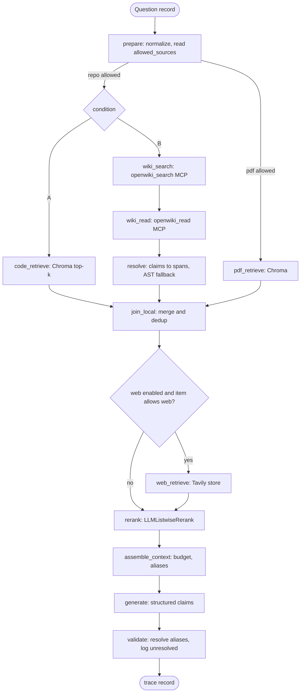
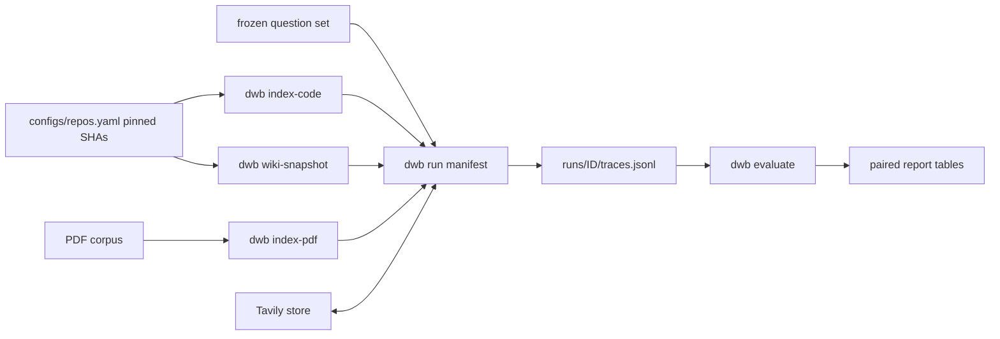
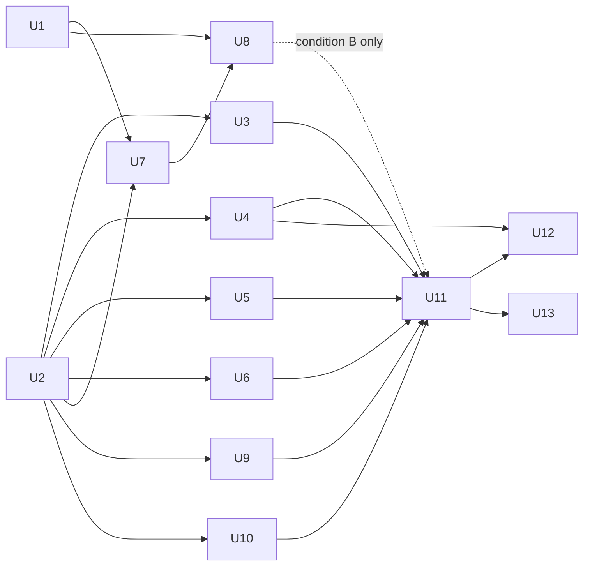

# Cross-Source QA Research System - Plan

## Goal Capsule

**Objective.** Build the research code for the CIBSE journal extension: one LangGraph query graph with two interchangeable repository-retrieval branches (vector baseline, OpenWiki-guided), shared downstream stages, a manifest-driven batch runner, and a separate offline evaluation command.

**Authority hierarchy.** `docs/journal-extension-plan.md` owns the study design (RQs, conditions, benchmark protocol, analysis). This plan owns the implementation decisions (KTDs below). `CLAUDE.md` owns environment and workflow rules. Where this plan and the journal plan disagree on a mechanism, this plan wins and U13 updates the journal plan's wording.

**Stop conditions.**
- Stop after U1 if the OpenWiki spike shows `.claims` evidence missing or not in `repo://path#Lx-Ly` form. Revise KTD4 and U8 with the user before building U7–U8.
- Stop and ask before installing any package (see Dependencies).
- Stop if a shared-stage change would apply to only one condition (violates R6).

**Execution profile.** Python 3.11 in conda env `taxonomy`. Node 22 for the OpenWiki CLI and MCP server. No live network calls in the default test suite.

**Tail ownership.** Each unit lands as its own commit on a feature branch. The user merges. Per `CLAUDE.md`, every local commit comes with a paste-ready PR description.

---

## Product Contract

### Summary

Implement the system described in `docs/journal-extension-plan.md` §Implementation and §LangGraph design. Settle its open mechanisms: LLM listwise reranking, OpenWiki over MCP, claims-based span resolution, item-declared Web use, Chroma plus OpenAI embeddings, and structured-claim answers. Deliver tooling for benchmark records and offline scoring. Do not deliver the curated benchmark content itself.

### Problem Frame

The journal plan is a study design. It fixes conditions, controls, and evaluation, but leaves the reranker, the OpenWiki interface, span resolution, the Web trigger, the baseline stack, and the citation format open. The schedule allows three weeks (Nov 15 – Dec 5, 2026). The test set must be frozen by Nov 28. The code must be correct the first time it runs paired conditions, and every run must be replayable from saved artifacts.

### Requirements

**Evidence and traceability**
- R1. Every evidence item carries a stable ID, a source type (`code`, `pdf`, `web`), text, and a locator: code is commit/path/line range, PDF is document version/page, Web is URL/capture ID/passage.
- R2. Evidence IDs survive retrieval, merge, reranking, context assembly, and generation. Validation logs every cited ID that does not resolve.
- R3. Answers cite only original evidence. Wiki text is never cited. Wiki section references stay in the trace.

**Conditions and shared stages**
- R4. The experiment configuration selects condition A (vector code retrieval) or condition B (OpenWiki search → read → resolve) per run.
- R5. If condition B yields no resolved spans, the other enabled branches still contribute evidence. When no other branch is enabled (public items), the trace records an explicit empty-context outcome and the item stays in the paired report. Vector retrieval is never substituted.
- R6. PDF retrieval, the Web policy, the reranker, the context budget, the generator, and the citation format are identical code paths and configurations in both conditions.
- R7. Each branch logs how many candidates it returned. Condition A and B repository candidate budgets are configurable to allow matching.

**Web**
- R8. Web retrieval runs only after the local branches finish, and only for items whose record allows the `web` source type. Public SWE-QA items never allow `web`.
- R9. Every Tavily request and response is persisted. The quality study replays saved responses. A replay miss is an error, not a silent live call.

**Reproducibility and runs**
- R10. A batch run is driven by a manifest. It persists repo SHA, document and wiki snapshot IDs, models, prompts, retrieval limits, candidate lists per stage, final context, answer, citations, per-stage timing and token usage, and failures.
- R11. Each OpenWiki snapshot records its generator version, provider, model, configuration, cost, and elapsed time, and is pinned to one repository SHA.

**Benchmark tooling**
- R12. Question records store question, repo SHA, expected claims, acceptable evidence spans with alternatives, allowed source types, partial-credit rules, and provenance (upstream split and row ID, or custom author). The test set is frozen by content hash. Development questions are stored separately.

**Evaluation**
- R13. Evaluation is a separate command over saved traces. It never runs during generation.
- R14. Evaluation reports evidence recall (at candidates and at final context), required-claim correctness, citation support and coverage, and per-stage cost. Each metric is reported as paired differences and as improved/tied/regressed counts, split by public vs. custom items.

### Key Decisions

- Benchmark content (item selection, authoring, annotation, second review) is human work. This plan delivers only its schemas, loaders, validators, and freeze tooling. Governs R12.
- The baseline is labeled "Langflow-style". The conference Langflow export and settings are not available, so the code makes no claim of conference equivalence. Governs R4.

### Scope Boundaries

- Paper writing, figures, and the conference-to-journal change table are out of scope.
- The 27-question conference migration replay is out of scope (optional in the origin plan).
- Jev and pytest as a third repository are out of scope. The pytest reserve only needs `configs/repos.yaml` to accept another entry.
- Live-Tavily latency measurement is a flag on the runner, not a separate study.

### Deferred to Follow-Up Work

- A cross-encoder reranker backend behind the KTD3 interface, only if a sensitivity analysis is wanted.
- A matched-budget control run. The R7 logging makes it possible, but the origin plan drops it first when time is short.

### Dependencies

Each item needs the user's approval before install (per `CLAUDE.md`):
- `langchain-mcp-adapters` (KTD2).
- `langchain-chroma` with `chromadb` (KTD5).
- `datasets` or `huggingface_hub` to load SWE-QA (U4).
- `openwiki` from npm, version pinned globally or in a local `package.json` (KTD6). Node 22.22.3 is already installed and meets the ≥22.22.0 requirement.

Already in `taxonomy`: langgraph 1.2.4, langchain 1.3.4, langchain-core 1.4.1, langchain-classic 1.0.7, langchain-openai 1.2.2, deepeval 4.1.8, tavily-python 0.7.25, pydantic 2.12.5, tiktoken 0.13.0, pyyaml, pypdf, pymupdf, pytest 9.1.1, ruff 0.16.3.

External prerequisites the plan does not produce: `OPENAI_API_KEY` and `TAVILY_API_KEY`; the PDF corpus per repository; frozen question records from the human curation work.

---

## Planning Contract

### Key Technical Decisions

- KTD1. **Evidence IDs are deterministic and are aliased per prompt.** The stable ID is a short hash of source type plus canonical locator. Prompts show short aliases (`E1…En`), and generation output maps the aliases back. Hashing makes the same span carry the same ID across conditions and runs. That is what makes paired comparison and evidence recall comparable. Aliases keep prompts short and give the validator a closed set to check.
- KTD2. **OpenWiki is reached through `langchain-mcp-adapters` over a stdio MCP server.** Graph nodes call `openwiki_search` and `openwiki_read` directly as tools. No agent chooses the calls. (session-settled: user-approved — chosen over the raw `mcp` SDK client and reading wiki files directly: keeps the "native OpenWiki search/read" claim true with the least glue.)
- KTD3. **The reranker is `LLMListwiseRerank` from `langchain_classic.retrievers.document_compressors`, wrapped in a small `Reranker` interface.** It returns the same `Document` objects reordered, so evidence IDs travel in `metadata`. The wrapper caps the input pool and asks for a ranking of the full pool. It parses that ranking leniently, discarding out-of-range and negative positions. It then checks for dropped or duplicated documents: dropped ones are appended in their original order, duplicates are removed, and both are logged. Only after that does it cut to the KTD14 `top_n`. Tokens and latency are recorded through a usage callback. The model is the pinned generator-family OpenAI model at `temperature=0`. (session-settled: user-directed — chosen over a cross-encoder: user preference for an LangChain LLM reranker.)
- KTD4. **The resolver reads claims first and falls back to AST lookup.** For each section returned by `openwiki_read`, it collects the section's Claims evidence from `openwiki/.claims/` (`repo://path#Lstart-Lend`). It then checks that the file exists at the pinned SHA and that the lines are in range. Fallback: file paths and dotted symbols in the section text are resolved through Python `ast` to the line range of the `def`/`class` (whole file only when a path is named without a symbol). Everything else is logged as unresolved with its raw text. The exact link between a section and its claims is confirmed in U1. (session-settled: user-approved — chosen over claims-only resolution and deciding after the spike: deterministic primary path, with a fallback in case claim coverage is sparse.)
- KTD5. **Condition A and the PDF retriever use Chroma with a pinned OpenAI embedding model.** There is one persisted collection per (repository SHA, chunking config, embedding model) and one per (PDF corpus version, embedding model). Code chunking uses `ast`: one chunk per top-level function, class, or method, with a fallback of 60-line windows overlapping by 10 for non-Python files and module-level code. (session-settled: user-approved — chosen over FAISS with local embeddings and over matching the unavailable conference stack: smallest install, and langchain-openai is already present.)
- KTD6. **Wiki snapshots are generated with the `openwiki` CLI, never through a coding agent.** The npm version, `OPENWIKI_PROVIDER`, and `OPENWIKI_MODEL_ID` are pinned, and telemetry is off (`OPENWIKI_TELEMETRY_DISABLED=1`). Each snapshot is a copy of the generated `openwiki/` tree stored outside the checkout, plus a snapshot manifest. (session-settled: user-approved — chosen over coding-agent integration: cost and configuration must be attributable and reproducible.)
- KTD7. **The Web policy is declared by each item.** The Web node runs only when Web is enabled in the run manifest and the item's `allowed_sources` contains `web`. It is a conditional edge after the local-branch join. The trace records `web_triggered`. (session-settled: user-approved — chosen over coverage-, score-, or LLM-based triggers: identical across conditions by construction; score thresholds are not comparable between vector and wiki branches.)
  - *Revised 2026-11-21* by `docs/plans/2026-11-21-0929-feat-conditional-web-search-plan.md`: with `web.conditional_web_search` on (the default), web also requires a shared LLM judge (`check_local`) to find the local evidence insufficient. This reverses the rejection of LLM-based triggers: the same judge model, prompt and evidence budget apply in both conditions, so the rule stays identical by construction even when the verdicts differ. Setting the flag to `false` restores the rule above.
- KTD8. **Tavily calls go through a record/replay store keyed by a hash of the normalized request.** The modes are `record` (live call, persist request, response, and capture timestamp), `replay` (read only, a miss raises an error), and `live` (call only, for the latency flag). It uses only the SDK `search` and `extract` calls, never `research()`.
- KTD9. **The generator returns structured claims.** Through `with_structured_output`, it emits `claims: [{text, evidence_ids}]` plus an optional summary sentence. The prose answer is rendered from the claims. Validation maps aliases to stable IDs and logs unresolved or out-of-context IDs. (session-settled: user-approved — chosen over inline bracket IDs: claim boundaries come for free for the claim/cited-span evaluator.)
- KTD10. **One pinned OpenAI chat model serves both generation and reranking.** Its exact model ID lives in the manifest. The evaluation judge is a separately pinned model recorded in the evaluation config. (session-settled: user-directed — chosen over Anthropic and over a split-provider setup.)
- KTD11. **The graph is an explicit `StateGraph` with deterministic routing.** Repository and PDF branches fan out in parallel and join before the Web gate. `join_local` is added with `defer=True`, so it runs once after all active branches finish, even when the branches have different lengths. List-valued state written by parallel branches (stage records, candidates) uses an `Annotated[list, operator.add]` reducer. The graph runs async (`ainvoke`), because the MCP tools are async. Each node appends a stage record (latency, tokens, counts) to the state. No Deep Agents and no LLM routing.
- KTD12. **Candidate merging drops identical canonical locators and code spans contained in a larger span from the same file.** The larger span survives. Each dropped ID is kept as an alias in the surviving item's provenance, so any ID logged before the merge still resolves (R2).
- KTD13. **Persistence is file-based.** A run directory holds `manifest.yaml` (frozen copy), `traces.jsonl` (one record per question), and `run_summary.json`. Snapshots (indexes, wikis, Tavily store) live under `artifacts/` and are referenced by content ID. Large artifacts are gitignored. Their manifests are committed.

Proposed defaults, to confirm in the U11 pilot and then freeze:
- KTD14. **Budgets.** Maximum span size 1,500 tokens: any code chunk (U5) or resolved span (U8) larger than this is split into windowed sub-spans by one shared helper, identically in both conditions. Condition A top-k 20 code chunks. Condition B: top 10 search results, read the top 5 sections, keep at most 20 resolved spans. PDF top-k 10. Reranker input pool cap 40, `top_n` 12. Context budget 8,000 tokens counted with tiktoken.
- KTD15. **Span matching for evidence recall.** A retrieved code span matches an annotated span when the path is the same and the line ranges overlap by at least one line. Any acceptable alternative counts. A Jaccard ≥ 0.5 variant is reported as a sensitivity check. PDF matches on document plus page. Web matches on URL plus passage overlap.
- KTD16. **The claim evaluator uses the pinned judge model at `temperature=0`.** Required-claim correctness: each rubric claim is judged supported, partial, or missing against the answer's claims, using the item's partial-credit rules. Citation support: each answer claim is judged against the concatenation of its cited passages, so joint support counts. Coverage is the share of material claims with supporting citations. DeepEval contextual recall and faithfulness run as diagnostics only.

### High-Level Technical Design

Query graph (one run = one condition):



Offline pipeline and artifact flow:



Evidence item (directional shape, not a final signature):

```
EvidenceItem
  id:          hash(source_type, canonical_locator)   # KTD1
  source_type: code | pdf | web
  text:        str
  locator:     CodeLocator(commit, path, start_line, end_line)
             | PdfLocator(doc_id, doc_version, page)
             | WebLocator(url, capture_id, passage_index)
  provenance:  {branch, rank, score, wiki_section?, resolution_method?}
```

### Assumptions

- `openwiki_search` and `openwiki_read` return structured content (page and section anchors) that can be parsed without an LLM. U1 confirms this.
- Each wiki section's claims can be found from its page front matter or the `.claims/` sidecar layout. U1 confirms this.
- SWE-QA rows for Flask and Requests can be loaded from the Hugging Face dataset with stable row identifiers.
- The PDF corpus per repository (for example PEP 3333 and RFC 9110 saved as PDF) is chosen by the user. The PDF retriever does not depend on which documents are chosen.

### Output Structure

```
pyproject.toml
configs/
  repos.yaml                  # pinned SHAs per repository
  manifests/                  # run manifests (A and B per repository)
  eval.yaml                   # judge model, matching rules
src/dwb/
  evidence.py  manifest.py  trace.py  budget.py
  benchmark/  schemas.py  swe_qa.py  freeze.py
  retrieval/  chunking.py  code_index.py  pdf_index.py  openwiki_client.py  resolver.py
  web/        tavily_store.py
  rerank.py  generate.py  graph.py  runner.py  cli.py
  eval/       matching.py  recall.py  claims_judge.py  deepeval_diag.py  report.py
data/
  questions/  test/  dev/      # question records (JSONL), frozen hash file
tests/
  fixtures/   toy_repo/  openwiki/  mcp_responses/  tavily/
  ...one test module per source module
docs/spikes/                  # U1 findings
artifacts/                    # gitignored: indexes, wiki snapshots, Tavily store
runs/                         # gitignored: traces
```

### Sequencing



The schedule mapping follows the origin plan. Nov 15–21: U1–U6, then U9–U11 with condition A only, ending with the first traced answer. Nov 22–28: U7, U8, condition B in U11, U12, pilot, freeze KTD14–KTD16. Nov 29 – Dec 5: paired runs and U13.

Cut order if behind schedule, applied before touching any unit that the paired runs depend on:
1. The Jaccard sensitivity variant (KTD15).
2. Live Tavily mode (KTD8). Record and replay stay.
3. Judge-result caching and DeepEval diagnostics (U12).
4. The README rewrite (U13). The CLAUDE.md commands and the journal-plan wording fixes stay.

---

## Implementation Units

| U-ID | Title | Key files | Depends on |
|---|---|---|---|
| U1 | Spike: pin revisions, verify items, inspect OpenWiki | `docs/spikes/`, `configs/repos.yaml`, `tests/fixtures/` | — |
| U2 | Package scaffold and evidence model | `pyproject.toml`, `src/dwb/evidence.py` | — |
| U3 | Manifest and trace store | `src/dwb/manifest.py`, `src/dwb/trace.py` | U2 |
| U4 | Benchmark record tooling | `src/dwb/benchmark/` | U2 |
| U5 | Code and PDF vector indexes | `src/dwb/retrieval/chunking.py`, `code_index.py`, `pdf_index.py` | U2 |
| U6 | Tavily record/replay store | `src/dwb/web/tavily_store.py` | U2 |
| U7 | OpenWiki snapshot and MCP client | `src/dwb/retrieval/openwiki_client.py` | U1, U2 |
| U8 | Wiki reference resolver | `src/dwb/retrieval/resolver.py` | U1, U7 |
| U9 | Reranker wrapper | `src/dwb/rerank.py` | U2 |
| U10 | Context assembly, generation, validation | `src/dwb/budget.py`, `src/dwb/generate.py` | U2 |
| U11 | Query graph and batch runner | `src/dwb/graph.py`, `src/dwb/runner.py`, `src/dwb/cli.py` | U3–U6, U9, U10 (U8 for condition B) |
| U12 | Offline evaluation command | `src/dwb/eval/` | U4, U11 |
| U13 | Documentation alignment | `CLAUDE.md`, `README.md`, `docs/journal-extension-plan.md` | U11 |

### U1. Spike: pin revisions, verify items, inspect OpenWiki

**Goal:** Pin the Flask and Requests SHAs, verify five SWE-QA items per repository, and capture real OpenWiki output as test fixtures.

**Requirements:** R11, R12. This unit is the gate for KTD4.

**Dependencies:** None. It needs approval to install `datasets` (or `huggingface_hub`) and the pinned `openwiki` npm package.

**Files:**
- `docs/spikes/2026-11-openwiki-swe-qa-spike.md` (findings, revision-selection rationale, mismatches)
- `configs/repos.yaml` (repository URL, SHA, SWE-QA subset name)
- `tests/fixtures/openwiki/` (one copied page, its `.claims` sidecar, `.page-manifest.json`)
- `tests/fixtures/mcp_responses/` (raw `openwiki_search` and `openwiki_read` results)

**Approach:**
1. Choose a candidate SHA per repository that matches the SWE-QA source revision when it is documented. Otherwise use the closest release tag.
2. Check five items per repository: reference answers and named symbols exist at the SHA. Record any mismatch.
3. Run `openwiki --init` on the Flask checkout with the KTD6 pinning. Record version, provider, model, cost, and elapsed time.
4. Start the stdio MCP server and call `openwiki_search` and `openwiki_read` by hand for two questions. Save the raw responses.
5. Trace one cross-file question from wiki hit to `.claims` range to the original span. Record whether the KTD4 claims-first path works as assumed.

**Execution note:** This is investigation. The deliverable is the findings doc plus fixtures, not production code.

**Test expectation:** none — spike output feeds the U7 and U8 tests.

**Verification:** The findings doc answers: the stdio MCP server launch command, the section→claims link, the claim locator format, the MCP response shapes, the snapshot cost and time, the pinned SHAs, and the five-item check results. If the claims path fails, the user reviews a revised KTD4 before U7 starts.

### U2. Package scaffold and evidence model

**Goal:** Create the installable `dwb` package and the evidence item model with deterministic IDs.

**Requirements:** R1, R2.

**Dependencies:** None.

**Files:**
- `pyproject.toml` (src layout, pytest and ruff config, `live` marker)
- `src/dwb/__init__.py`, `src/dwb/evidence.py`
- `.gitignore` (add `artifacts/`, `runs/`)
- `tests/test_evidence.py`

**Approach:** Use pydantic models for the three locator types and `EvidenceItem` (see the HTD shape). Stable ID per KTD1. Provide helpers to convert to and from a LangChain `Document`, keeping the ID and locator in `metadata`. Include a canonical locator string used for dedup (KTD12) and matching (KTD15).

**Patterns to follow:** None in the repo yet. Use pydantic v2 conventions.

**Test scenarios:**
- The same locator and source type always produce the same ID, and changing the line range changes the ID.
- Converting an item to a `Document` and back preserves ID, source type, text, and locator exactly.
- A code locator with start line > end line, or a non-positive line, is rejected.
- A PDF locator without a document version is rejected.
- The canonical locator string sorts and compares stably across the three source types.

**Verification:** `pytest tests/test_evidence.py` passes, and the package imports in `taxonomy` after an editable install.

### U3. Manifest and trace store

**Goal:** Define run manifests and the per-question trace record, and persist them as described in KTD13.

**Requirements:** R10, R11, R13.

**Dependencies:** U2.

**Files:**
- `src/dwb/manifest.py`, `src/dwb/trace.py`
- `configs/manifests/flask-A.yaml`, `configs/manifests/flask-B.yaml` (examples)
- `tests/test_manifest.py`, `tests/test_trace.py`

**Approach:**
- The manifest holds: run ID, condition, repository SHA, question set ID and hash, index and snapshot IDs, models (generator, reranker, embedding), prompt IDs with hashes, KTD14 budgets, Web mode, and Tavily store ID.
- The trace holds: question ID, per-stage records (name, latency, tokens, candidate IDs and counts), wiki section refs, unresolved refs, merged IDs, `web_triggered`, final context IDs, claims, rendered answer, validation results, and errors.
- Starting a run copies the manifest into the run directory. Traces are appended as JSONL with a flush after each record, so a crash keeps the completed questions.

**Test scenarios:**
- A manifest with an unknown condition or missing model ID fails validation with a clear message.
- A `check_paired(manifest_a, manifest_b)` helper fails when manifests A and B differ in any shared-stage field (reranker, generator, context budget, Web mode). Covers R6.
- A difference in repository candidate budgets is reported by `check_paired` but does not fail it. Covers R7.
- Appending three traces and reloading returns three equal records in order.
- A trace with an error and no answer still serializes and reloads.
- Prompt hash changes when the prompt text changes.

**Verification:** Both example manifests load, and the paired check passes for them.

### U4. Benchmark record tooling

**Goal:** Provide the question record schema, the SWE-QA loader, validation, and the test-set freeze.

**Requirements:** R12, R8 (public items cannot allow Web).

**Dependencies:** U2. Needs approval for `datasets`.

**Files:**
- `src/dwb/benchmark/schemas.py`, `swe_qa.py`, `freeze.py`
- `data/questions/test/`, `data/questions/dev/` (empty, with README notes)
- `tests/benchmark/test_schemas.py`, `test_swe_qa.py`, `test_freeze.py`

**Approach:**
- `QuestionRecord` fields follow R12, with `kind: public | custom` and `allowed_sources`.
- The SWE-QA loader selects rows by upstream split and row ID listed in a selection file, and writes draft records whose `allowed_sources` is `[code]`.
- Validation checks annotated spans against the pinned checkout (the file exists and lines are in range).
- Freeze writes a hash file over the sorted records, and the runner refuses a test set whose hash differs from the manifest.

**Test scenarios:**
- A public record whose `allowed_sources` includes `web` fails validation. Covers R8.
- A custom record without expected claims or without at least one code and one external acceptable span fails validation.
- The loader keeps the upstream split and row ID and records excluded rows with a reason.
- An annotated span past the end of the file fails validation against the toy repo fixture.
- Changing any record changes the freeze hash, and reordering records does not.
- Dev and test sets with an overlapping question ID are rejected.

**Verification:** A draft Flask public set loads from the selection file and validates against the pinned checkout.

### U5. Code and PDF vector indexes

**Goal:** Build the condition A code index and the shared PDF index using Chroma and a pinned OpenAI embedding model (KTD5).

**Requirements:** R1, R4, R7.

**Dependencies:** U2. Needs approval for `langchain-chroma`.

**Files:**
- `src/dwb/retrieval/chunking.py`, `code_index.py`, `pdf_index.py`
- `tests/fixtures/toy_repo/` (small Python package with tests)
- `tests/retrieval/test_chunking.py`, `test_code_index.py`, `test_pdf_index.py`

**Approach:**
- AST chunking per KTD5. Every chunk becomes an `EvidenceItem` with a code locator at the pinned SHA.
- The index ID is a hash of SHA, chunking config, and embedding model. An existing collection is reused, never rebuilt silently.
- PDF ingestion is per page with pymupdf, producing PDF locators with the document version.
- Retrieval returns `EvidenceItem`s with rank and score in provenance.
- Tests use a fake embedding function so they need no network.

**Test scenarios:**
- A file with two functions and a class with one method yields four chunks with correct line ranges.
- A non-Python file and module-level code fall back to 60-line windows with 10-line overlap.
- A syntax-error Python file falls back to windows and logs a warning instead of crashing.
- A class larger than the KTD14 maximum span size is split into contiguous sub-spans that cover its full line range, each under the cap.
- Building an index twice with the same inputs reuses the collection ID.
- Retrieval with k=3 returns three items with valid locators and descending rank.
- A two-page PDF fixture yields two items with pages 1 and 2 and the document version.
- `live` marker: indexing the toy repo with the real embedding model returns non-empty results.

**Verification:** The `dwb index-code` and `dwb index-pdf` commands build persisted indexes for the toy fixtures, and the index IDs are recorded.

### U6. Tavily record/replay store

**Goal:** Wrap the Tavily SDK `search` and `extract` calls in the KTD8 record/replay store.

**Requirements:** R9, R1 (web locators).

**Dependencies:** U2.

**Files:**
- `src/dwb/web/tavily_store.py`
- `tests/fixtures/tavily/` (recorded responses)
- `tests/web/test_tavily_store.py`

**Approach:**
- The request key is a hash of the normalized parameters (query, search depth, max results, include and exclude domains).
- Each record stores the request, the raw response, the capture timestamp, and a capture ID.
- Results become Web `EvidenceItem`s with URL, capture ID, and passage index.
- Live mode is never the default.

**Test scenarios:**
- Record mode with a stubbed client persists exactly one record, and replay returns identical evidence items.
- A replay miss raises a typed error naming the request key.
- Two requests that differ only in parameter order share one key.
- Evidence IDs from replay match the IDs created at record time.
- The code never references `research()` (static check in the test).

**Verification:** Replaying the fixture store produces Web evidence without network access.

### U7. OpenWiki snapshot and MCP client

**Goal:** Add the `dwb wiki-snapshot` command (KTD6) and an async client for `openwiki_search` and `openwiki_read` through `langchain-mcp-adapters` (KTD2).

**Requirements:** R3, R11, R4.

**Dependencies:** U1, U2. Needs approval for `langchain-mcp-adapters` and the pinned `openwiki` npm package.

**Files:**
- `src/dwb/retrieval/openwiki_client.py`
- `src/dwb/cli.py` (`wiki-snapshot` subcommand)
- `tests/retrieval/test_openwiki_client.py`

**Approach:**
1. The snapshot command runs the CLI on a clean checkout at the pinned SHA with the pinned environment. It copies `openwiki/` to `artifacts/wikis/<snapshot-id>/` and writes a snapshot manifest (R11).
2. The client opens one persistent MCP session per run (`client.session(...)` plus `load_mcp_tools(session)`) and reuses it for every question. It exposes `search(query, k)` and `read(section_refs)`. Server startup time is recorded once, as a run-level stage.
3. Both methods parse the result shapes captured in U1 into typed section references and section contents.
4. Section text never becomes an `EvidenceItem` (R3).

**Test scenarios:**
- Parsing the U1 search fixture returns ranked section references with page and anchor.
- Parsing the U1 read fixture returns full section text with its page and anchor.
- An empty search result returns an empty list, not an error. Covers R5.
- A server start failure raises a typed error that includes the server's stderr.
- The snapshot manifest contains version, provider, model, SHA, cost, and elapsed time, and the snapshot ID changes when any of them changes.
- `live` marker: search and read against the U1 Flask snapshot return at least one section.

**Verification:** One Flask snapshot is registered, and a scripted search plus read through the client matches the U1 manual results.

### U8. Wiki reference resolver

**Goal:** Turn read sections into code and test `EvidenceItem`s at the pinned SHA (KTD4).

**Requirements:** R1, R3, R5.

**Dependencies:** U1, U7.

**Files:**
- `src/dwb/retrieval/resolver.py`
- `tests/retrieval/test_resolver.py`

**Approach:**
1. Claims path: find the claims for each read section, parse `repo://path#Lstart-Lend`, validate against the checkout, and emit spans with `resolution_method=claim`.
2. Fallback path: extract file paths and dotted symbols from the section text, resolve them through `ast` in the pinned checkout, and emit spans with `resolution_method=ast`.
3. Log unresolved references with the section ID and the raw text.
4. Split spans above the KTD14 maximum span size with the shared helper. Then keep at most the KTD14 condition B resolved-span cap (20), ordered by search rank and then claim order.

**Test scenarios:**
- A claim `repo://src/app.py#L10-L20` on the toy repo yields one span with lines 10–20 and the pinned SHA.
- A claim pointing to a missing file, or to lines past the end of the file, is logged as unresolved and emits nothing.
- Section text naming `toy.app.App.run` resolves through AST to the method's line range.
- Section text naming a file path only resolves to the whole-file span.
- An ambiguous symbol with two definitions emits both spans and records the ambiguity.
- A section with no claims and no recognizable references yields zero spans and one unresolved entry. Covers R5.
- Spans resolved from two sections with the same locator are emitted once.
- Integration with the U1 fixtures: the traced cross-file question resolves to the span recorded in the spike doc.

**Verification:** On the U1 Flask snapshot, most claim references for five sample questions resolve, and the unresolved rate is reported.

### U9. Reranker wrapper

**Goal:** Wrap `LLMListwiseRerank` behind a `Reranker` interface that keeps evidence IDs and logs cost (KTD3).

**Requirements:** R2, R6, R10.

**Dependencies:** U2.

**Files:**
- `src/dwb/rerank.py`
- `tests/test_rerank.py`

**Approach:**
- The input pool is capped at the KTD14 limit, ordered by branch rank with branches interleaved round-robin, so neither branch wins by position alone.
- Usage is captured with a callback handler, and latency with a timer around `compress_documents`.
- The library's `compress_documents` truncates to its own `top_n`, and its `_parse_ranking` indexes `docs[i]` without bounds checks. The wrapper therefore builds its own chain from the library's prompt and `RankDocuments` schema. The chain has a lenient parse step that drops out-of-range and negative positions and logs them in the stage record.
- Post-check on the full ranking: compare input and output IDs, append dropped items in their original order, and remove duplicates, recording both cases in the stage record. Then cut to `top_n`.
- `from_llm` rejects models without `with_structured_output`. Offline tests therefore use a fake chat model that implements structured output, so the parse step is exercised.

**Test scenarios:**
- With a fake chat model returning ranking `[2, 0, 1]`, the output order follows it and every output `Document` keeps its original evidence ID.
- A ranking that omits an index still returns that document after the ranked ones and logs it as dropped.
- A ranking with a duplicate index returns each document once and logs the duplicate.
- A 40-item pool with a complete ranking returns exactly 12 items and logs zero drops.
- A fake model returning `[45, -1, 0]` for a 3-item pool logs two invalid positions and returns document 0 first, followed by documents 1 and 2.
- A pool larger than the cap is truncated by interleaved branch rank before the LLM call.
- Token usage and latency are recorded in the stage record.
- `live` marker: the pinned OpenAI model at temperature 0 gives the same ranking on two consecutive calls for a fixed input. If it does not, the result is recorded, not failed.

**Verification:** The wrapper is swappable through the interface, and a stub backend passes the same ID-preservation tests.

### U10. Context assembly, generation, validation

**Goal:** Assemble the budgeted context with aliases, generate structured claims, and validate citations (KTD1, KTD9).

**Requirements:** R2, R3, R6.

**Dependencies:** U2.

**Files:**
- `src/dwb/budget.py`, `src/dwb/generate.py`
- `prompts/generate_v1.md`
- `tests/test_budget.py`, `tests/test_generate.py`

**Approach:**
- Context assembly fills the KTD14 token budget in reranked order. It truncates only at item boundaries and assigns `E1…En` aliases.
- The prompt is a versioned file whose hash goes into the manifest.
- Generation uses `with_structured_output` (KTD9) and renders a prose answer from the claims.
- Validation maps aliases to stable IDs and flags aliases that are unknown or outside the context.

**Test scenarios:**
- Items that exceed the budget are excluded whole, and the included set is a prefix of the reranked order.
- Aliases are contiguous from E1 and map one-to-one to stable IDs.
- A fake model output that cites `E99` is logged as unresolved, and its claim is kept with an empty resolved list.
- A claim with no citations is kept and marked uncited.
- A structured-output parse failure records an error in the trace instead of crashing the run.
- The rendered answer contains every claim text in order.

**Verification:** A canned context produces a validated claim set with zero unresolved IDs using a fake model.

### U11. Query graph and batch runner

**Goal:** Assemble the `StateGraph` (KTD11) and the manifest-driven batch runner and CLI.

**Requirements:** R4–R10.

**Dependencies:** U3, U4, U5, U6, U9, U10. U8 gates only the condition B branch, so condition A is built and piloted before U7 and U8 land.

**Files:**
- `src/dwb/graph.py`, `src/dwb/runner.py`, `src/dwb/cli.py`
- `tests/test_graph.py`, `tests/test_runner.py`

**Approach:**
- Nodes and edges follow the HTD query graph. Branch nodes are added only for sources the item allows and the manifest enables.
- `join_local` merges and deduplicates (KTD12). The Web gate is a conditional edge (KTD7).
- The runner loads the manifest, checks the question-set hash, invokes the graph per question with per-question error capture, and writes traces and a run summary.
- CLI subcommands: `index-code`, `index-pdf`, `wiki-snapshot`, `run`, `evaluate`.

**Execution note:** Start with a failing end-to-end graph test on the toy fixtures with fake retrievers and models, then replace the fakes one stage at a time.

**Test scenarios:**
- Condition A on the toy fixtures produces a trace with stage records for prepare, code_retrieve, join_local, rerank, assemble_context, generate, and validate, and no wiki stages.
- Condition B with the same question produces wiki_search, wiki_read, and resolve stages, and identical downstream stage configuration. Covers R6.
- Condition B with an empty wiki search still produces PDF evidence in the final context. Covers R5.
- In a condition B trace with PDF enabled, join_local, rerank, and generate each appear exactly once.
- A public item in condition B with an empty wiki search produces a trace marked empty-context, with no fallback to vector retrieval. Covers R5.
- A public item never triggers the Web node, even when Web is enabled in the manifest. Covers R8.
- A custom item that allows Web, in replay mode, triggers the Web node, and `web_triggered` is true.
- A replay miss records an error for that question, and the run continues with the next question.
- A question-set hash mismatch aborts the run before any question is processed.
- The run directory contains the frozen manifest, one trace line per question, and a summary with failure counts.
- Wiki section references appear in the trace but never in the final context or the claims. Covers R3.

**Verification:** A pilot run on three dev questions per condition completes with the real models. The KTD14 budgets are reviewed against the pilot traces and frozen in the manifests.

### U12. Offline evaluation command

**Goal:** Implement `dwb evaluate` over saved traces: recall, claim correctness, citation support and coverage, cost, and paired reporting.

**Requirements:** R13, R14.

**Dependencies:** U4, U11.

**Files:**
- `src/dwb/eval/matching.py`, `recall.py`, `claims_judge.py`, `deepeval_diag.py`, `report.py`
- `configs/eval.yaml`
- `prompts/judge_claim_v1.md`, `prompts/judge_support_v1.md`
- `tests/eval/test_matching.py`, `test_recall.py`, `test_claims_judge.py`, `test_report.py`

**Approach:**
- Matching follows KTD15. The judges follow KTD16 with a pinned model.
- Judge results are cached per (trace ID, claim, prompt hash), so a rerun costs nothing.
- DeepEval runs as a library over the saved context and answer, with no tracing and no Confident AI.
- The report pairs A and B by question ID and writes CSV tables plus improved/tied/regressed counts, split by public and custom items.

**Test scenarios:**
- A span overlapping an annotated span by one line counts as a match, and a span on an adjacent line does not.
- A match on any acceptable alternative counts, and the Jaccard variant is reported separately.
- Recall is computed at both the candidate stage and the final context stage from the same trace.
- With a fake judge, a claim supported only by two citations jointly is scored supported.
- Coverage counts an uncited material claim as uncovered.
- Pairing two runs with a question missing from one side reports it and excludes it from the paired statistics.
- The evaluator never imports the graph or calls a generator. A static import check enforces R13.
- A second evaluation of the same traces uses the cache and makes no judge calls.

**Verification:** Evaluating the U11 pilot traces produces all four metric tables and a paired summary. Evaluator config and disagreement logs are written next to the report.

### U13. Documentation alignment

**Goal:** Make the repository docs match the settled decisions and the new commands.

**Requirements:** Supports R6 and R10 traceability.

**Dependencies:** U11.

**Files:**
- `CLAUDE.md` (build, test, and run commands; reranker and MCP no longer undecided)
- `README.md` (setup, commands, layout)
- `docs/journal-extension-plan.md` (replace "cross-encoder reranker" with the LLM listwise reranker; state the item-declared Web policy and the Langflow-style baseline wording)

**Approach:** Edit only the mechanism wording. The study design text stays unchanged.

**Test expectation:** none — documentation only.

**Verification:** No document in the repo still describes the reranker as a cross-encoder or OpenWiki access as undecided.

---

## Risks

| Risk | Effect | Mitigation |
|---|---|---|
| OpenWiki claims are sparse or not linked to sections | Condition B under-resolves, which hurts recall for a tooling reason | U1 gate, AST fallback (KTD4), unresolved rate reported as a finding |
| OpenWiki npm version changes the MCP tool shapes | Client parsing breaks mid-study | Pin the npm version; U7 parses the captured fixtures and fails loudly |
| LLM reranker is not fully deterministic at temperature 0 | Paired differences include reranker noise | Record rankings in the trace; U9 live determinism check; report as a validity threat |
| Listwise prompt with 40 candidates exceeds or strains the context window | Truncated or degraded ranking | Pool cap (KTD14) and a token check before the call |
| SWE-QA reference answers drift from the pinned SHA | Unfair scoring of public items | U1 five-item check and U4 span validation against the checkout |
| Same model family generates and judges | Self-preference bias in the judge | Separately pinned judge model; blinded human audit of a stratified sample (origin plan) |
| Schedule slip before the Nov 28 freeze | Unfrozen benchmark | Build and pilot condition A first; follow the origin plan's reduction order |

---

## Verification Contract

- Unit and integration tests: `conda run -n taxonomy pytest` passes with no network access. Tests marked `live` are skipped by default.
- Live checks: `conda run -n taxonomy pytest -m live` passes with `OPENAI_API_KEY` set and the U1 snapshot present. Run this before the pilot.
- Lint: `conda run -n taxonomy ruff check src tests` is clean.
- Paired-configuration gate: the U3 `check_paired` helper passes for every A/B manifest pair before a paired run.
- End-to-end smoke: one dev question per repository runs through both conditions in replay mode and produces valid traces with zero unresolved citation IDs.
- Evaluation smoke: `dwb evaluate` over the smoke traces produces every report table.

---

## Definition of Done

- U1–U13 meet their verification criteria.
- Every A/B manifest pair passes the paired gate. Wiki snapshots, indexes, and the Tavily store are referenced by ID in the manifests.
- A full pilot (three dev questions per repository per condition) completes, and KTD14–KTD16 values are frozen in the manifests and `configs/eval.yaml`.
- `CLAUDE.md` lists the build, test, run, and evaluate commands.
- Abandoned experiments, dead code, and unused fixtures from approaches that did not work out are removed before merge.

---

## Sources

- `docs/journal-extension-plan.md` — study design and origin of the R-IDs.
- OpenWiki README (github.com/langchain-ai/openwiki): Node CLI, stdio MCP tools `openwiki_search` and `openwiki_read`, model-free local search, Claims evidence as `repo://path#Lx-Ly`, provider pinning through `OPENWIKI_PROVIDER` and `OPENWIKI_MODEL_ID`, telemetry opt-out.
- `langchain_classic.retrievers.document_compressors.LLMListwiseRerank` (langchain-classic 1.0.7): positional integer IDs in one structured-output call; returns the input `Document` objects reordered.
- SWE-QA benchmark: huggingface.co/datasets/swe-qa/SWE-QA-Benchmark.
