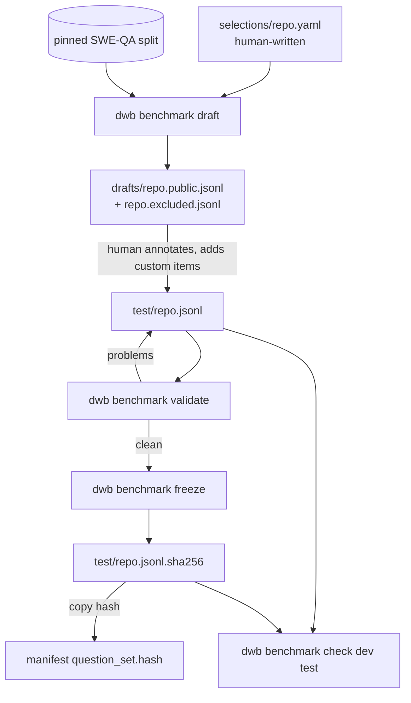

# Benchmark Curation Commands - Plan

## Goal Capsule

- **Objective.** Add a `dwb benchmark` command group so a human curator can draft, validate, freeze, and check question sets from the terminal, using the existing functions in `src/dwb/benchmark/`.
- **Authority hierarchy.** `docs/journal-extension-plan.md` owns the benchmark protocol. `docs/plans/2026-11-15-1948-feat-cross-source-qa-research-system-plan.md` owns the question-record schema (its R8, R12) and the freeze rules. This plan owns only the command surface. `CLAUDE.md` owns environment and workflow rules.
- **Stop conditions.**
  - Stop if a requirement would change `QuestionRecord` or the freeze hash; both are frozen contracts.
  - Stop and ask before installing any package. None is expected (`huggingface_hub` and `pymupdf` are already in `taxonomy`).
  - Stop if any command would generate question text, claims, or evidence spans. Curation stays human (CLAUDE.md, deepeval section).
- **Execution profile.** Python 3.11 in conda env `taxonomy`. Default tests stay offline; the SWE-QA download path is tested with a fake fetcher.
- **Tail ownership.** Work lands on branch `feat/benchmark-cli` as unit commits. The user merges; every local commit comes with a paste-ready PR description.

---

## Product Contract

### Summary

Add four `dwb benchmark` commands. `draft` turns a selection file into draft public question records and an exclusions file. `validate` checks annotated records against the schema, the pinned checkout, and the PDF corpus. `freeze` locks a validated set by its hash. `check` proves the dev and test sets are disjoint and that a frozen set still matches its hash.

### Problem Frame

The curation steps exist only as library functions (`build_drafts`, `validate_against_checkout`, `freeze`, `check_disjoint`). A curator must write scripts to use them, and nothing checks PDF spans or reports all problems in one pass. The test set must be built and frozen by Nov 28 (journal plan schedule), so the curation loop must be cheap to repeat: edit records, validate, fix, validate again, freeze.

### Requirements

**Drafting public items**

- R1. `dwb benchmark draft <selection>` writes draft public records for the included rows and an exclusions file with each excluded row and its reason.
- R2. `draft` never overwrites an existing drafts file unless `--overwrite` is given, so annotations cannot be lost.
- R3. `draft` refuses a selection whose dataset revision or repository SHA differs from the pins in `configs/repos.yaml`.
- R4. `draft` loads the pinned SWE-QA split from `artifacts/swe-qa/`, and downloads it at the pinned revision when it is missing. Either way, the file hash must match the pin.

**Validating records**

- R5. `dwb benchmark validate <records>` reports every problem in one run and exits non-zero when any exists. Problems include schema errors with their line number, duplicate IDs, a `repo_sha` that differs from the pinned SHA, code spans outside the file at the pinned commit, and PDF spans whose document is not in the repository's PDF corpus or whose page is past the end of the document.
- R6. `validate` prints a summary: counts of public and custom items, items without evidence spans, and expected claims.

**Freezing and checking**

- R7. `dwb benchmark freeze <records>` validates first and checks disjointness against the repository's dev set (`data/questions/dev/<repo>.jsonl`) when it exists. It refuses when any problem or overlap exists, and otherwise writes `<records>.sha256` and prints the hash for the manifests' `question_set.hash`.
- R8. `dwb benchmark check <dev> <test>` fails when the sets share an ID, question text, or SWE-QA upstream row. When `<test>.sha256` exists, it also fails if the file no longer matches it. A missing test file counts as an empty set: `check` passes with a warning that the test set does not exist yet.

### Key Decisions

- **Drafts go to a separate file.** The curator copies annotated drafts into `data/questions/test/<repo>.jsonl`. This was chosen over merging rows into the test file, which could overwrite annotations. Governs R1, R2.
- **`freeze` prints the hash; it does not edit manifests.** Chosen over writing `question_set.hash` into test manifests, which would edit configs as a side effect. Governs R7.
- **`validate` checks PDF spans.** Chosen over checking code spans only. Governs R5.
- **A missing SWE-QA split is downloaded at the pinned revision.** Chosen over failing with an error. The hash check makes the download safe. Governs R4.

### Scope Boundaries

- No command authors question text, claims, or evidence spans; `draft` only copies existing SWE-QA rows into draft records. Selection files, custom items, claims, and evidence spans are written by people.
- No change to `QuestionRecord`, the freeze hash, or the runner's hash check in `load_question_set`.
- Web spans are checked for format only (the schema already requires a URL). Their URLs are not fetched.

#### Deferred to Follow-Up Work

- Test-set manifests (`configs/manifests/*-test.yaml`) and the A20 control manifests.
- A command that renders records as a review sheet for the second reviewer.

---

## Planning Contract

### Key Technical Decisions

- KTD1. **Orchestration lives in a new application-layer module, `src/dwb/curation.py`.** The CLI stays thin, matching `runner` and `eval.command`. The module reads `configs/repos.yaml` (including its `swe_qa` section) and `configs/chat.yaml` through `Workspace`, and calls the domain functions in `src/dwb/benchmark/`. It sits in layer 2 of the module view (`tests/test_layers.py`, `docs/architecture.md` §2).
- KTD2. **Validation collects problems; it does not raise on the first.** `validate` returns a report object holding the problems and the summary counts. Schema errors are caught per line, so one bad line does not hide the rest. `freeze` reuses the same report (R7).
- KTD3. **The PDF corpus comes from the repository's `pdf_corpus` in `configs/chat.yaml`, with a `--pdf-corpus` override.** This is the only existing repository-to-corpus mapping. Page counts are read with `pymupdf`, as `src/dwb/retrieval/pdf_index.py` already does. A PDF file missing from `artifacts/pdfs/` is reported as a problem rather than skipped.
- KTD4. **Disjointness also compares SWE-QA upstream row IDs.** Extend `check_disjoint` in `src/dwb/benchmark/freeze.py` rather than adding a second check. Dev item `flask-dev-pub-000` is SWE-QA row `flask:0`, and a test draft of the same row would get a different ID and could have edited text.
- KTD5. **The SWE-QA download and the checkout reader are injectable.** `draft` takes the fetch function as a parameter (default `fetch_split`), so tests use a fake fetcher and stay offline. Validation takes a reader factory (default `RepoReader.from_git` on the pinned checkout), so tests read `tests/fixtures/toy_repo`, which has no `.git`, through `RepoReader.from_dir`.
- KTD6. **Exit codes follow the CLI's convention.** Usage and setup errors exit 2 through `_fail` in `src/dwb/cli.py`. Found problems (validation, overlap, stale hash) exit 1, so scripts can tell "bad input" from "bad records". A missing or unreadable pinned checkout is a setup error: a `WorkspaceError` naming the clone step (see "Adding a research repository" in `docs/usage.md`), never a traceback. A record naming a repository absent from `configs/repos.yaml`, or carrying PDF spans for a repository with no `pdf_corpus`, is a per-record problem.

### High-Level Technical Design

The curation loop the commands support:

### Sources

- `src/dwb/benchmark/swe_qa.py`: `Selection`, `load_split`, `fetch_split`, `build_drafts`.
- `src/dwb/benchmark/schemas.py`: `QuestionRecord` rules (R8), `validate_against_checkout`, `load_records`, `save_records`.
- `src/dwb/benchmark/freeze.py`: `records_hash`, `freeze`, `verify`, `check_disjoint`.
- `src/dwb/runner.py`: `load_question_set` (the hash check `freeze` feeds).
- `configs/repos.yaml`: repository pins and the `swe_qa` section (revision, local dir, per-split sha256).
- `docs/spikes/2026-11-openwiki-swe-qa-spike.md` §1: row ID scheme `<split>:<line index>`.

---

## Implementation Units

### U1. Curation module: pins and drafting

- **Goal:** Draft public records from a selection file against the pinned SWE-QA split.
- **Requirements:** R1, R2, R3, R4; KTD1, KTD5.
- **Dependencies:** none.
- **Files:**
  - `src/dwb/curation.py` (new)
  - `src/dwb/workspace.py` (accessor for the `swe_qa` pins; `swe_qa_split` on `RepoInfo`)
  - `tests/test_curation.py` (new)
  - `tests/test_layers.py` (add `curation` at layer 2)
- **Approach:**
  1. Load the `swe_qa` pin (revision, local dir, per-split sha256) from `configs/repos.yaml` through the workspace root.
  2. Compare the selection's `dataset_revision` and `repo_sha` with the pins; a mismatch is a setup error naming both values.
  3. Locate the split file; when missing, call the injected fetcher at the pinned revision, then load with the pinned sha256.
  4. Call `build_drafts`; write records and exclusions to `data/questions/drafts/<repo>.public.jsonl` and `<repo>.excluded.jsonl`, refusing existing files unless overwrite is set.
- **Patterns to follow:** `Workspace.resolve` for paths; the `save_records` writer; the error style of `WorkspaceError` (message names the fixing step).
- **Test scenarios:**
  - A selection including rows 1 and 3 and excluding row 2 writes two drafts with upstream IDs `flask:1` and `flask:3`, and one exclusion with its reason.
  - An existing drafts file is not overwritten without the overwrite flag; with it, the file is replaced.
  - A selection with a different `dataset_revision` fails and names the pinned revision.
  - A selection with a different `repo_sha` fails and names the pinned SHA.
  - A missing split file calls the fake fetcher once with the pinned revision, then loads it.
  - A split file whose hash differs from the pin fails, whether local or fetched.
  - The drafts directory is created when absent.
- **Verification:** the tests pass offline, and `tests/test_layers.py` accepts the new module.

### U2. Validation report

- **Goal:** Report every problem in a record file in one pass, with summary counts.
- **Requirements:** R5, R6; KTD2, KTD3, KTD5.
- **Dependencies:** U1 (module and workspace plumbing).
- **Files:**
  - `src/dwb/curation.py`
  - `tests/test_curation.py`
- **Approach:**
  1. Parse records line by line; record schema errors with the line number and continue.
  2. Flag duplicate IDs and records whose `repo_sha` differs from the pinned SHA of their repository.
  3. Run `validate_against_checkout` per repository with a reader from the injected factory (KTD5).
  4. Check PDF spans against the corpus from KTD3: unknown `doc_id`, missing PDF file, page past the end.
  5. Return a report with problems and counts (public, custom, items without evidence spans, expected claims).
- **Patterns to follow:** `RepoReader.from_git` as used in `tests/benchmark/test_swe_qa.py`; `PdfCorpus.load` in `src/dwb/retrieval/pdf_index.py`.
- **Test scenarios:**
  - A clean file with one public and one custom item gives no problems and the right counts.
  - A malformed JSON line and a schema-invalid line (a public item allowing `web`) are both reported with line numbers, and the valid lines are still checked.
  - Two records with the same ID give one duplicate-ID problem.
  - A code span past the end of the file, and a span on a missing file, are each reported (using the `tests/fixtures/toy_repo` checkout).
  - A PDF span with an unknown `doc_id`, and one with a page past the last page, are each reported (using a small generated PDF fixture).
  - A corpus PDF missing on disk is reported once, not once per span.
  - A record pinned to a different SHA than `configs/repos.yaml` is reported.
  - A record naming an unknown repository, and one with PDF spans for a repository without a `pdf_corpus`, are each reported as problems.
  - A missing pinned checkout raises a setup error naming the clone step, with no traceback (default git reader).
- **Verification:** each problem type appears in the report; a clean fixture reports none.

### U3. Freeze and check

- **Goal:** Lock a validated set and prove dev/test separation.
- **Requirements:** R7, R8; KTD2, KTD4.
- **Dependencies:** U2.
- **Files:**
  - `src/dwb/benchmark/freeze.py` (extend `check_disjoint`)
  - `src/dwb/curation.py`
  - `tests/benchmark/test_freeze.py`
  - `tests/test_curation.py`
- **Approach:**
  1. `freeze` runs the U2 report and, when the repository's dev set exists, `check_disjoint` against it; any problem or overlap stops it, and no `.sha256` file is written.
  2. On a clean report, call the existing `freeze` and return the hash.
  3. `check_disjoint` also compares `provenance.upstream_row_id` (ignoring records without one).
  4. `check` loads both files (a missing test file is an empty set, with a warning), runs `check_disjoint`, and verifies `<test>.sha256` when present.
- **Test scenarios:**
  - Freezing a clean file writes `.sha256` matching `records_hash`, and the runner's `load_question_set` accepts a manifest carrying that hash.
  - Freezing a file with a problem writes nothing and returns the problems.
  - Freezing a test file that shares an upstream row with the repository's dev set writes nothing and names the row.
  - `check` on a dev file against a nonexistent test path passes with a warning.
  - Dev and test sharing an upstream row but with different IDs and text fail the check.
  - Custom items without upstream rows never collide on that field.
  - A test file edited after freezing fails `check` as stale; the same file without a `.sha256` passes.
  - The existing `test_freeze.py` cases still pass unchanged.
- **Verification:** the existing benchmark tests and the new cases pass.

### U4. CLI command group

- **Goal:** Expose the four commands as `dwb benchmark draft|validate|freeze|check`.
- **Requirements:** R1–R8; KTD6.
- **Dependencies:** U1, U2, U3.
- **Files:**
  - `src/dwb/cli.py`
  - `tests/test_curation.py`
  - `tests/test_chat.py` (add the new commands to `test_every_command_has_help`)
- **Approach:** add a `benchmark` Typer sub-app beside `index`, `wiki`, and `experiment`. Each command calls `curation`, prints the report as a rich table (problems) or JSON (hash, counts) per the CLI's stdout/stderr split, and maps outcomes to the KTD6 exit codes.
- **Patterns to follow:** `wiki_app` and `exp_app` in `src/dwb/cli.py`; `CliRunner` usage in `tests/test_chat.py`.
- **Test scenarios:**
  - `validate` on a file with problems exits 1 and lists them; on a clean file it exits 0 and prints counts.
  - `draft` with a mismatched pin exits 2 with the pin named.
  - `freeze` prints the hash and the hint to copy it into `question_set.hash`.
  - `check` with overlapping sets exits 1 and names the shared IDs or rows.
  - `dwb benchmark --help` and each subcommand's `--help` show usage.
- **Verification:** `dwb benchmark --help` lists four commands; the CLI tests pass.

### U5. Documentation

- **Goal:** Document the curation loop where curators and maintainers look.
- **Requirements:** R1–R8.
- **Dependencies:** U4.
- **Files:**
  - `docs/usage.md` (Research harness: a "Building the test set" block)
  - `data/questions/README.md` (drafts directory and the loop)
  - `docs/architecture.md` (§2 module view: `curation` in the application layer)
  - `CLAUDE.md` (Commands list)
- **Approach:** describe the loop in the High-Level Technical Design order, with one example command each. State that `freeze` prints the hash for the manifest and that drafts are not overwritten unless `--overwrite` is given.
- **Test expectation:** none -- documentation only; `tests/test_layers.py` already enforces the module view's layer list.
- **Verification:** each command named in the docs exists in `dwb benchmark --help`.

---

## Verification Contract

| Gate | Command | Applies to |
|---|---|---|
| Offline tests | `conda run -n taxonomy pytest` | every unit |
| Lint | `conda run -n taxonomy ruff check src tests` | every unit |
| Layering | `tests/test_layers.py` (part of the suite) | U1 |
| Smoke | `conda run -n taxonomy dwb benchmark validate data/questions/dev/flask.jsonl` exits 0 | U4 |
| Graph refresh | `graphify update .` | after code changes |

## Definition of Done

- All four commands work as R1–R8 describe, and the gates above pass.
- Validating the existing dev sets (`data/questions/dev/*.jsonl`) reports no problems; `check` on dev against an empty or absent test set passes.
- No change to `QuestionRecord` or to the freeze hash of an unchanged file.
- Docs in U5 match `dwb benchmark --help`.
- No abandoned experimental code remains in the diff.

---

## Deferred / Open Questions

### From 2026-11-17 review

- **Clean validate lets freeze lock unreviewed, unannotated drafts** — Product Contract, freeze requirement (P1, adversarial, confidence 75)

  A test set can be frozen before the study protocol says it is ready. The protocol requires revision-verified reference answers for public items and a resolved second review before freezing. Validation treats neither as a problem: items without evidence spans are only counted, and drafts carry upstream answers unchanged. So raw drafts validate clean and freeze, and the manifest hash makes the mistake expensive to undo once runs start. Open choice: should freeze print a protocol checklist and require an explicit review-confirmation flag before writing the hash?
