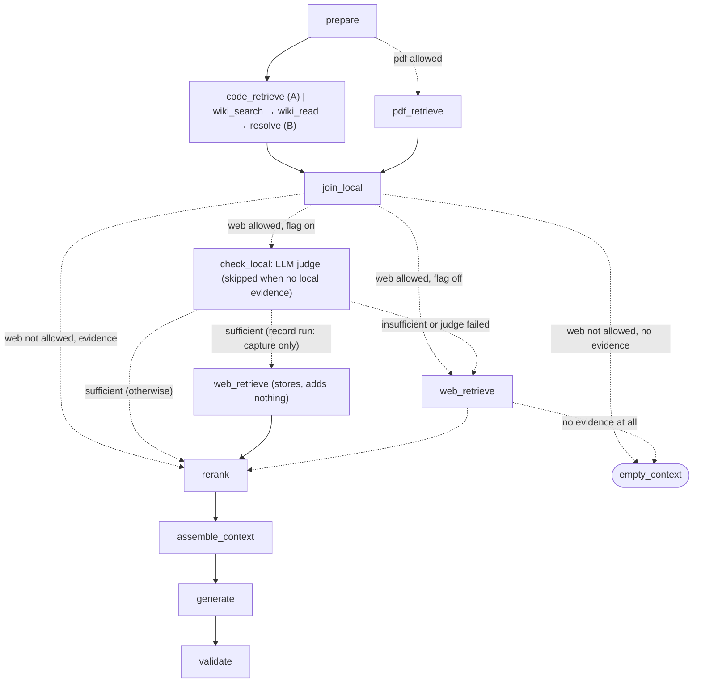

# Conditional Web Search - Plan

## Goal Capsule

- **Objective:** make the query graph search the web only when the local evidence (code or wiki, plus PDFs) is insufficient to answer the question, behind a `conditional_web_search` flag that defaults to on.
- **Authority:** this plan, then KTD7 as revised here, then `docs/plans/2026-11-15-1948-feat-cross-source-qa-research-system-plan.md` for everything this plan does not touch. CLAUDE.md invariants (shared downstream stages, replayable web, degraded-not-failed sources) still bind.
- **Stop conditions:** stop and ask if the gate cannot be made identical across conditions A and B, or if keeping replay complete would require changing the Tavily store format.
- **Execution profile:** one feature branch, code changes plus docs; offline tests only (live tests stay opt-in).

---

## Product Contract

### Summary

Frame the workflow as a narrow search that extends to the web only when needed. The local branches run as today and join. A new check asks one LLM judge whether the joined local evidence can answer the question. Web retrieval runs only when the question allows web and the judge says the evidence is insufficient. Setting `conditional_web_search: false` restores today's behavior (web whenever allowed).

### Problem Frame

The current web step is a policy gate, not a fallback: `route_after_join` sends every web-eligible question to Tavily, however good the local evidence is (`src/dwb/graph.py`, KTD7 in the original plan). The study design asks for "Web fallback needed and enabled?" (`docs/journal-extension-plan.md`), and the paper wants to describe a narrow-then-wider search. KTD7 rejected coverage-, score- and LLM-based triggers in favor of a rule that is identical across conditions by construction, noting that scores are not comparable between the vector and wiki branches. This plan reverses the LLM-trigger rejection: one judge with the same pinned model, prompt and evidence budget applies in both conditions, which keeps the rule identical by construction even though its verdicts may differ per condition.

### Requirements

- R1. With `conditional_web_search` on, web retrieval runs only when the question allows web (manifest enables web and `allowed_sources` includes `web`) **and** the local evidence is judged insufficient.
- R2. With `conditional_web_search` off, behavior matches today exactly: web runs whenever the question allows it, and no judge call is made.
- R3. The flag defaults to on in experiment manifests, `configs/chat.yaml` and user-mode `.dwb/config.yaml`.
- R4. The judge is identical in both conditions: same pinned model, temperature 0, same versioned prompt (hash recorded), same evidence budget. `experiment check` fails when A and B differ on the flag or the judge prompt.
- R5. Empty local evidence counts as insufficient without calling the judge, and the trace records it as an insufficient verdict ("no local evidence").
- R6. A failed judge call routes to web (when allowed) and marks the question degraded with a warning; it never fails the question.
- R7. The trace records, per question: whether the gate ran, the verdict, the judge's one-line reason, and whether web evidence entered the pool (`web_triggered`). The evaluation report carries the verdict per question.
- R8. Experiment runs in record mode capture web results for every web-eligible question whatever the verdict, so a replay run of either condition never misses because its verdict differed from the recording run's. Only questions the gate routes to web use those results.
- R9. Public SWE-QA items (no `web` in `allowed_sources`) never reach the judge or the web.
- R10. The paired report splits web-eligible questions by verdict agreement between A and B (both sufficient, both insufficient, discordant) and reports each condition's escalation rate, so score differences on discordant items are read as branch-plus-gate effects, not retrieval alone.
- R11. `ask` and `chat` tell the user when the gate is on, and when web was skipped because local evidence was judged sufficient.

### Scope Boundaries

- No query planning, sub-queries, sub-agents, question classification, or multi-round search loops.
- No new reranking pass: the judge reads the local evidence before reranking (KTD-W2).
- No CLI flag for the gate; it is set in configuration.
- The paper figure script (session scratchpad) is not updated here.

### Deferred to Follow-Up Work

- Measuring judge reliability against full hand labels on the dev set (the success criteria below cover the web-needing subset only).

### Success Criteria

- On the dev set with web-eligible items, `web_triggered` is true only where the verdict is insufficient (or the judge failed), in both conditions.
- On dev cross-source items whose reference evidence includes a web source, the number the judge marks sufficient is reported per condition; a non-trivial rate blocks keeping the flag's default on until the prompt is revised (on dev questions only).
- Replay runs of A and B after one record run complete with no `replay miss`.
- All offline tests and lint pass.

---

## Planning Contract

### Key Technical Decisions

- **KTD-W1. Narrow search first, web only on insufficient local evidence; no planning or sub-agents.** (session-settled: user-directed — chosen over an article-style deep-research agent with planner, specialists and loops: keeps the A/B comparison controlled.)
- **KTD-W2. A separate `check_local` node after `join_local` runs an LLM sufficiency judge over the merged local evidence, interleaved by branch and cut to the context budget, with no extra rerank.** The node records a stage (latency, tokens, model, prompt hash) and writes the verdict to state; a routing function reads it. Routing functions cannot write state, so the verdict would otherwise not reach the trace. Accepted consequence: the judge's slice (interleaved order) can differ from the generator's (reranked order) when the pool exceeds the budget, so `web_check` records the evidence IDs the judge saw, letting the analysis measure how many reached the final context. (session-settled: user-approved — chosen over a score threshold, which KTD7 rejected as not comparable across branches, and over reranking local evidence first, which costs a second rerank call whenever web runs.)
- **KTD-W3. The flag is `web.conditional_web_search: bool = True`.** Off reproduces the old routing exactly. (session-settled: user-directed — chosen over an `always | insufficient` trigger enum: a boolean is enough.) Consequence accepted: existing Flask manifests switch to conditional, so earlier dev runs are not directly comparable to new ones.
- **KTD-W4. A judge failure is treated as insufficient** (web runs if allowed) and recorded as a warning, so the question is degraded, not failed. (session-settled: user-approved — chosen over treating it as sufficient: missing evidence costs more than an extra web call.)
- **KTD-W5. Experiment record runs capture web for every eligible question; only routed questions use it.** The `web_retrieve` node runs for eligible questions in record mode even when the verdict is sufficient, stores the result, and returns no candidates. `web_triggered` stays false for those. Chat, which also uses record mode as a cache, does not capture-all: it searches only when routed. The runner tells the graph which behavior applies. (session-settled: user-approved — chosen over recording only what each run routes, which would make a B replay miss where A judged sufficient.)
- **KTD-W6. The judge uses the generator's pinned model** (`models.generator`, per KTD10's single pinned model) and a new versioned prompt `prompts.sufficiency`. A run that needs the judge (web enabled, flag on) and lacks the prompt stops at start (`experiment run`, `experiment check`) with an error naming the key; manifests still *load* without it, so saved runs from before this change (web on, no flag, no judge prompt) stay loadable by `experiment evaluate`. Chat and user mode fill in the shipped default, as they do for `generate`.
- **KTD-W7. The judge lives in a new pipeline module (layer 3, `pipeline` side)** beside `generate`, with a structured output of a boolean verdict plus a one-line reason, and a stub for offline tests.
- **KTD7 (original plan) is revised:** "Web runs when the run enables it, the item allows it, and — when `conditional_web_search` is on — the local evidence is judged insufficient by a shared LLM judge." The original plan gets a supersession note pointing here that says the LLM-trigger rejection is reversed and why (same judge, prompt and budget in both conditions, so the rule stays identical by construction).

### High-Level Technical Design

With no merged local evidence, `check_local` makes no judge call and records an insufficient verdict (R5). In the compiled graph the "capture only" path is the same `web_retrieve` node reading the verdict; it is drawn separately here for clarity.

### Assumptions

- The generator model is good enough as a sufficiency judge at temperature 0; its reliability is reported, not tuned (deferred follow-up).
- Tavily request keys depend only on the query and web settings, so a capture made in one condition replays in the other (true today: `request_key` hashes the normalized request).

### Sequencing

U1 → U2 → U3 → U4 → U5. U2 and U1 are independent and may land in either order; U3 needs both.

---

## Implementation Units

### U1. Configuration: the flag and the judge prompt

**Goal:** add `conditional_web_search` everywhere web is configured, and require the judge prompt where it will be used.
**Requirements:** R2, R3, R4; KTD-W3, KTD-W6.
**Dependencies:** none.
**Files:** `src/dwb/manifest.py`, `src/dwb/project.py`, `src/dwb/chat.py`, `src/dwb/workspace.py`, `configs/chat.yaml`, `configs/manifests/*.yaml`, `tests/test_manifest.py`, `tests/test_project.py`, `tests/test_chat.py`.
**Approach:**
1. `WebConfig` gains `conditional_web_search: bool = True`. A run-start check (not a load-time validator, per KTD-W6) requires `prompts.sufficiency` when web is enabled and the flag is on, with an error that names the key to add.
2. `check_paired` needs no new code (it diffs `web` and `prompts` whole); add a test that proves it.
3. Chat defaults (`configs/chat.yaml` web block, the `ChatWeb` model) and user mode (`WebCfg`, `chat_config`) carry the flag; `build_manifest` passes it into `WebConfig` and adds `prompts.sufficiency` from the shipped default.
4. Add `prompts.sufficiency` to the Flask and Requests manifests that enable web.
**Test scenarios:**
- A manifest without the flag loads with `conditional_web_search` true.
- Web enabled, flag on, no `prompts.sufficiency` → `experiment check` and run start fail with an error naming the key.
- Web enabled, flag off, no `prompts.sufficiency` → run start passes.
- Web disabled → run start passes without the judge prompt.
- A saved run manifest from before this change (web on, no flag key, no judge prompt) loads, so `experiment evaluate` still accepts it.
- `check_paired` fails when A and B differ only on the flag, and when they differ only on the sufficiency prompt.
- A user-mode `.dwb/config.yaml` without the flag yields a chat manifest with the flag on and a sufficiency prompt; `conditional_web_search: false` in the config reaches the manifest.
**Verification:** all shipped manifests load; `dwb experiment check` passes for the Flask pair.

### U2. The sufficiency judge

**Goal:** a judge that returns a verdict, a reason and a stage record, plus its prompt.
**Requirements:** R4, R6; KTD-W6, KTD-W7.
**Dependencies:** none.
**Files:** `src/dwb/sufficiency.py` (new), `src/dwb/prompt_files/sufficiency_v1.md` (new), `src/dwb/prompts.py`, `tests/test_sufficiency.py` (new), `tests/test_layers.py`, `tests/graph_fakes.py`.
**Approach:**
- Mirror `Generator` in `src/dwb/generate.py`: load the versioned prompt with `load_prompt`, structured output, usage callback, and a `StageRecord` named `check_local` with model, prompt hash, tokens and latency.
- The prompt asks whether the evidence lets the question be answered with cited claims, requiring a verdict and one sentence of reason; it must not ask the model to answer the question. It answers insufficient unless every part of the question can be supported by a passage, matching the cost asymmetry in KTD-W4.
- On any exception return verdict `None` plus the error in the stage, never raise.
- Register the module in `LAYERS` as layer 3, `pipeline`. Add a fake judge to `graph_fakes` with a configurable verdict, and make `components()` supply it by default with verdict insufficient, so existing web tests (which load the shipped manifests, now flag on) keep their routing.
**Test scenarios:**
- A fake chat model returning `sufficient: true` with a reason yields that verdict, reason, the prompt hash and token counts in the stage.
- A fake returning `sufficient: false` yields false.
- A model that raises yields verdict `None` and the error text in the stage, without raising.
- The prompt file loads, has the user marker, and its template takes `question` and `context`.
- The layer test passes with the new module.
**Verification:** `tests/test_sufficiency.py` and `tests/test_layers.py` pass.

### U3. Graph: the `check_local` gate and record-mode capture

**Goal:** route web through the gate and record the outcome in the trace.
**Requirements:** R1, R2, R5, R6, R7, R8, R9; KTD-W2, KTD-W4, KTD-W5.
**Dependencies:** U1, U2.
**Files:** `src/dwb/graph.py`, `src/dwb/trace.py`, `src/dwb/runner.py`, `src/dwb/chat.py`, `tests/test_graph.py`, `tests/test_degraded.py`, `tests/test_runner.py`, `tests/test_trace.py`.
**Approach:**
1. `Components` gains an optional judge; `build_components` creates it from `models.generator` and `prompts.sufficiency` when web is enabled and the flag is on. `build_graph` raises `ValueError` when web is enabled, the flag is on and no judge is supplied.
2. `route_after_join`: web not allowed → as today; allowed and flag off → `web_retrieve`; allowed and flag on → `check_local`.
3. `check_local` with no merged evidence makes no judge call and writes `web_check` = sufficient false, reason "no local evidence", judged false (R5). Otherwise it builds the judge's input with the existing pool interleaving (`interleave_pool`, capped at `rerank_pool`) and `assemble_context` at the context budget, calls the judge, and writes `web_check` (`sufficient`, `reason`, judged true, and the evidence IDs the judge saw). A `None` verdict adds a warning (KTD-W4).
4. The route after `check_local` goes to `web_retrieve` when the verdict is not true, or when `capture_all_web` is set (record-mode experiment runs); otherwise to `rerank`.
5. `web_retrieve` is capture-only exactly when `web_check` is present with `sufficient` true and `capture_all_web` is set. Then it returns no candidates, leaves `web_triggered` false and marks its stage `used: false`; a capture error is recorded on that stage only, with no warning (the question is not degraded). Every other path returns candidates as today, and a replay miss still raises.
6. `build_graph` takes the capture-all switch; the runner sets it for record-mode experiment runs; chat never sets it.
7. `TraceRecord` gains `web_check: dict | None`, filled by `trace_from_state`.
**Execution note:** start from failing graph tests for the four routing cases (not allowed, flag off, sufficient, insufficient) using the fake judge.
**Test scenarios:**
- Flag on, judge says sufficient, web allowed (replay store) → no `web_retrieve` stage, `web_triggered` false, `web_check.sufficient` true, answer generated from local evidence.
- Flag on, judge says insufficient → `web_retrieve` runs, `web_triggered` true, web IDs in the rerank pool.
- Flag off, web allowed → `web_retrieve` runs, no `check_local` stage, `web_check` is null (R2).
- Public item (no `web` in `allowed_sources`), flag on → no `check_local`, no web (R9).
- Flag on, no local candidates → no judge call, `web_check` records sufficient false with reason "no local evidence", `web_retrieve` runs (R5).
- Web enabled, flag on, no judge in `Components` → `build_graph` raises.
- Capture-all on, judge says sufficient, the store raises a non-replay error → error on the `web_retrieve` stage, no warning, `web_triggered` false.
- Flag on, no local candidates and web returns nothing → ends at `empty_context`.
- Judge raises → web runs, a `check_local` warning is recorded, question is degraded not failed (R6).
- Capture-all on, judge says sufficient, record store → the store holds the request, the pool has no web IDs, `web_triggered` false, stage `used: false` (R8).
- Capture-all on, judge says sufficient, replay store missing the request → `ReplayMiss` raises as today.
- Condition B with the same fakes produces the same `check_local` stage configuration as A (R4).
- `trace_from_state` round-trips `web_check`.
**Verification:** full offline suite passes; a condition A and B run on the dev manifests in replay mode completes with no replay miss after one record run.

### U4. Reporting and chat display

**Goal:** surface the verdict where people read results.
**Requirements:** R7, R10, R11.
**Dependencies:** U3.
**Files:** `src/dwb/eval/report.py`, `src/dwb/eval/command.py`, `src/dwb/chat.py`, `tests/eval/`, `tests/test_chat.py`.
**Approach:**
- The per-question report row gains `web_check` (`sufficient`, `insufficient`, `judge_failed`, or empty when the gate did not run); "no local evidence" maps to `insufficient`.
- The cost columns count the gate: `check_local` joins `rerank` and `generate` in the per-question `total_tokens`, and `web_retrieve` stages marked `used: false` (capture-only) are left out of latency and web live-call counts.
- The paired report adds a web-gate summary over web-eligible questions: counts by verdict agreement (both sufficient, both insufficient, discordant) and each condition's escalation rate, plus the count of "sufficient" verdicts on items whose reference evidence includes web (the success-criterion check).
- The chat sources line reads "web (when local evidence is insufficient)" when the flag is on.
- `ask --show-context` and the chat answer footer mention when web was skipped as unnecessary.
**Test scenarios:**
- A report row for a trace with a sufficient verdict shows `sufficient`; one without a gate shows empty.
- A trace with a `check_local` stage counts its tokens in `total_tokens`.
- Three paired web-eligible questions (A sufficient / B sufficient; A insufficient / B insufficient; A sufficient / B insufficient) give agreement counts 1/1/1 and escalation rates 1/3 for A and 2/3 for B.
- A web-reference item judged sufficient is counted in the success-criterion check; questions without web eligibility are left out of the summary.
- A trace with a capture-only `web_retrieve` stage excludes it from latency and from web live-call cost.
- The chat sources line with web on and the flag on includes "when local evidence is insufficient"; with the flag off it reads as today.
**Verification:** eval and chat tests pass.

### U5. Documentation

**Goal:** the docs describe the gate and the revised KTD7.
**Requirements:** R1–R11.
**Dependencies:** U3, U4.
**Files:** `docs/architecture.md`, `docs/usage.md`, `docs/plans/2026-11-15-1948-feat-cross-source-qa-research-system-plan.md`, `CLAUDE.md`.
**Approach:**
- `architecture.md`: add `check_local` to the graph diagram and text; revise decision row 11 (now "Web runs on insufficient local evidence, judged by a shared LLM judge"); list the new module in the layer table.
- `usage.md`: document `conditional_web_search` in `.dwb/config.yaml`, `configs/chat.yaml` and manifests; explain that record runs capture web for every eligible question (replaces "Run A with record first, so B replays identical web results" with the reason).
- Original plan: one-line note under KTD7 pointing to this plan.
- `CLAUDE.md`: the Web invariant mentions the sufficiency gate.
**Test expectation:** none -- documentation only.
**Verification:** the layer test still matches the architecture module view; docs name the flag and its default.

---

## Verification Contract

- `conda run -n taxonomy pytest` (offline suite) passes, including the new `tests/test_sufficiency.py` and the routing scenarios in `tests/test_graph.py`.
- `conda run -n taxonomy ruff check src tests` passes.
- `conda run -n taxonomy dwb experiment check configs/manifests/flask-A.yaml configs/manifests/flask-B.yaml` passes.
- Optional live smoke (needs keys): record then replay one web-eligible dev question in A and B; both replays complete with no `replay miss`.

## Definition of Done

- R1–R11 hold, each covered by at least one test scenario above.
- Existing graph tests pass with the default insufficient fake judge, and a flag-off variant reproduces the old routing with no judge call (R2).
- Docs and the original plan's KTD7 reflect the gate.
- No experimental or abandoned code is left in the diff.

## Deferred to Implementation

- Exact wording of the judge prompt (kept short; tuned only on dev questions, never on the frozen test set).
- Whether the judge sees the same `E1…` aliases as the generator or plain item numbers.

## Sources

- Conversation of 2026-11-19 to 2026-11-21 (graph figures, deep-research framing, decision to gate web on insufficient local evidence).
- `docs/plans/2026-11-15-1948-feat-cross-source-qa-research-system-plan.md` (KTD7, KTD10, KTD14, R5).
- `docs/journal-extension-plan.md` ("Web fallback needed and enabled?").
- Related work for framing only: H. Wandabwa, "Building a multi-agent deep research" (Substack, 2026-05-27), shallow-to-deep escalation on a weak answer.
