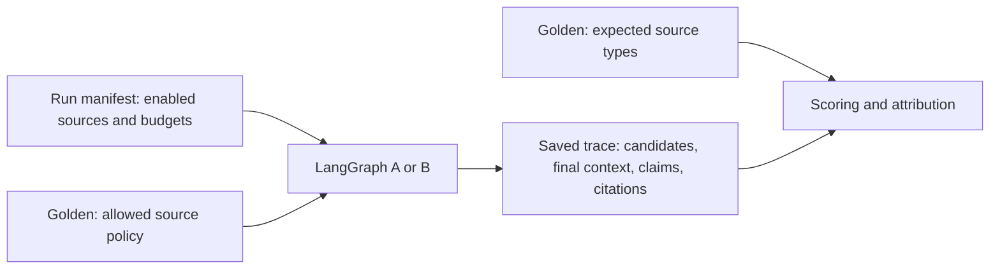

# DeepEval Golden Graph Evaluation - Plan

## Goal Capsule

**Objective.** Run the 35-item DeepEval Golden dataset in `tests/eval/.dataset.json` through both LangGraph experiment conditions, A and B, and score the saved traces with the project's existing retrieval, claim, citation, cost, and DeepEval metrics.

**User correction.** Expected source types are evaluation annotations. They must not switch graph branches on or off. In particular, a PDF-only Golden still runs through the repository branch in both conditions. The evaluator checks whether the final answer is supported by the expected PDF evidence and reports any code evidence returned or cited. The code branch may return little or no relevant content; it remains active.

**Authority.** `docs/journal-extension-plan.md` owns the research comparison. The existing research-system plan owns the graph and run contracts. This plan adds a separate Golden-backed evaluation path and does not weaken the public/custom benchmark curation contract or change the frozen question set.

## Problem Frame

The DeepEval dataset contains 25 curated benchmark questions and 10 generated variants. Its `Golden` records have questions, expected outputs, and metadata for answerability and source locators. The LangGraph runner currently loads `QuestionRecord` JSONL records instead. That schema requires every custom question to combine code and an external source, so it cannot represent all source combinations and abstention controls in the Golden dataset.

The current Golden metadata also needs to distinguish three different ideas:

1. **Expected source types:** sources that should substantiate the answer, used by scoring.
2. **Allowed sources:** source policy for an item, used by graph routing where applicable.
3. **Enabled sources:** branches enabled by the run manifest and experiment condition.

These values must not be copied from one another. The expected source types never decide which graph branches execute.

## Requirements

### Golden dataset and routing

- **R1. Preserve the Golden dataset as the curated input.** Load it with DeepEval's `EvaluationDataset` API. Do not hand-recreate the questions or generate more items as part of this work.
- **R2. Preserve the graph's repository branch.** Both A and B execute their configured repository branch for PDF-only questions. Expected source annotations must not be used to skip code retrieval or OpenWiki resolution.
- **R3. Separate source fields.** Each Golden has explicit `expected_source_types`, `allowed_sources`, and repository routing metadata. `expected_source_types` is scoring-only. `allowed_sources` and the run manifest define source eligibility. The manifest and condition define the enabled graph branches.
- **R4. Pin and route each Golden.** Every item has a stable ID, a repo target, and the matching repo SHA. Items shared by both repos can be assigned once to a chosen corpus or duplicated with distinct repo-scoped IDs; the routing map records that decision.
- **R5. Keep abstention controls.** Controls are explicit, local-corpus-only questions with expected behavior `abstain`. Their expected source set is empty; local retrieval branches remain active, and Web is excluded by an explicit control policy rather than by the source expectation label.
- **R6. Do not promote generated variants automatically.** Keep the 10 generated variants in this separate DeepEval/pilot dataset. Do not add them to `data/questions/test/` or the frozen research benchmark without human review and the existing curation workflow.

### Evidence and scoring

- **R7. Structure evidence annotations.** Convert source-locator strings into exact evidence requirements: code path and line range, PDF doc ID/version/page, or Web URL/passage. Record which expected claims each requirement supports. Generated variants inherit their parent's verified evidence and claims.
- **R8. Preserve actual retrieved context.** Do not place the reference answer into a Golden's `context` or `retrieval_context`. The run's final context comes from the graph trace and is the evidence used for Faithfulness and Contextual Recall.
- **R9. Measure expected-source use without disabling other sources.** Report expected evidence recall at candidate and final-context stages, plus source counts for candidates, final context, and citations. For a PDF-only item, code candidates can be nonzero; the report should expose that, while checking that expected PDF evidence is retrieved and that unsupported code is not used to justify the answer.
- **R10. Score controls as abstention cases.** Evaluate whether the answer correctly says the local evidence is insufficient. Do not interpret missing evidence requirements as zero recall; report evidence recall as not applicable for controls and score abstention separately.
- **R11. Reuse project metrics and DeepEval diagnostics.** Keep claim correctness, evidence recall, citation support and coverage, cost, and latency. Run DeepEval Contextual Recall and Faithfulness over saved traces. Add a focused abstention criterion only if the existing correctness and abstention fields do not give a reliable control score.

### Reproducibility and reports

- **R12. Run a paired experiment.** Each Golden is run once in condition A and once in condition B, using the same repo-scoped question set and shared-stage settings. Save a frozen manifest and trace for each condition.
- **R13. Pin all sources and models.** Record repo SHA, PDF corpus/index IDs, wiki snapshot ID, Web capture pool, model IDs, prompts, budgets, dataset hash, and question routing in the manifests and reports.
- **R14. Preserve existing question-set rules.** Add an experiment-specific Golden adapter/record type. Do not relax `QuestionRecord` validation for the existing public/custom curation path.

## Source-Use Semantics

The graph flow is controlled by the manifest, experiment condition, and item source policy. The expected-source labels are read only by evaluation.



For a PDF-only Golden, `expected_source_types` contains `pdf`; the repository branch remains active. The source-use report shows how much code was returned and whether any code evidence entered citations. A small or empty code result is desirable when the query is unrelated to the repo, but it is measured rather than forced by routing.

## Dataset Contract

Keep `tests/eval/.dataset.json` as the DeepEval-facing dataset. Enrich each Golden's `additional_metadata` with the following stable fields:

```json
{
  "benchmark_id": "cross-source-01",
  "repo": "flask",
  "repo_sha": "<pinned SHA>",
  "allowed_sources": ["code", "pdf"],
  "expected_source_types": ["pdf"],
  "expected_claims": ["..."],
  "evidence_requirements": [
    {
      "id": "e1",
      "supports_claims": ["c1"],
      "alternatives": [
        {"source_type": "pdf", "doc_id": "rfc9110", "version": "rfc9110-2022-06", "page": 73}
      ]
    }
  ],
  "answerability": "answerable",
  "derived_from": null
}
```

For abstention controls, use `answerability: "abstain"`, an empty `expected_source_types` list and no expected evidence requirements. Keep `allowed_sources` local-only for those questions so the existing Web policy cannot answer questions declared unanswerable from the local corpus. Their expected output remains an explicit evidence-bounded abstention.

The current `source_types` value should be migrated to `expected_source_types`; it describes the reference evidence basis, not retrieval permission. The current `source_locators` text should be replaced or supplemented with structured locators. Keep the existing `benchmark_id`, `derived_from`, and generated-item provenance.

## Key Decisions

- **KTD1. Golden-backed runs use a separate adapter.** A runner-facing `GoldenExperimentQuestion` maps `Golden.input` to the graph question, `Golden.expected_output` to the reference answer, and metadata to repo pinning, source policy, expected source types, claims, and evidence requirements. The current `QuestionRecord` rules remain unchanged.
- **KTD2. The adapter filters by repo target before running.** Each A/B manifest resolves the same Golden dataset hash, then selects the records routed to its repo. A Golden with multiple repo targets is duplicated in memory using stable IDs suffixed by repo; no duplicate question text is added to the canonical dataset.
- **KTD3. Expected source types are never a routing condition.** No edge in the graph is added or removed based on `expected_source_types`. Existing manifest and `allowed_sources` behavior remains responsible for actual availability, including the existing conditional Web gate.
- **KTD4. Source-use diagnostics are added alongside evidence recall.** Candidate and final-context counts are reported by source type. Citation source types and expected types are compared per question. This makes irrelevant code retrieval visible for PDF-only questions without penalizing the graph merely for running the code branch.
- **KTD5. The Golden dataset is a pilot/dev artifact until reviewed.** The existing project instructions require the research test set to remain human-curated and frozen. This plan evaluates the separate DeepEval dataset without changing that frozen-set contract.

## Corpus and Policy Changes

- Add the supplied Flask book cited by item 13 to the Flask PDF corpus and index it.
- Add the supplied project paper cited by item 20 to the PDF corpus used by the routed repo(s), then rebuild those PDF indexes. Preserve the existing RFC doc IDs and versions.
- Keep RFC 9110 available in both repo corpora; RFC 9112 remains in Requests and RFC 3875 in Flask.
- For the Requests Web-backed question, the current replay cache has no capture for its query, and the manifest excludes `requests.readthedocs.io`, the cited official docs host. Add a narrow per-item source-policy exception for this custom Golden, or revise its source/answer annotations to a different replayable Web source. Do not broadly remove the project-doc exclusion for all questions.
- Capture the final permitted Web request and response, then run both conditions against the same replay pool. A replay miss must remain visible as a run failure/degradation rather than silently switching to live Web search.

## Implementation Units

### U1. Golden annotation and validation

- **Goal:** Make every Golden runnable and scoreable without changing its wording or expected output.
- **Files:** `tests/eval/.dataset.json`, `tests/eval/README.md`, a new Golden validation module and tests.
- **Work:** Add repo targets and SHAs, separate `allowed_sources` from `expected_source_types`, structure claims/evidence, preserve parent links, and validate that each locator matches the pinned checkout or configured PDF/Web source. Confirm controls are scoped and marked as abstention items.
- **Acceptance:** All 35 IDs are unique; every item routes to at least one configured repo; generated variants point to a curated parent; no source expectation is inferred from source availability.

### U2. Experiment Golden adapter

- **Goal:** Let the existing manifest-driven runner consume the DeepEval dataset while leaving the curation schema intact.
- **Files:** `src/dwb/runner.py`, a new experiment Golden adapter module, `src/dwb/graph.py` type/interface updates, `src/dwb/eval/command.py`, and related tests.
- **Work:** Load with `EvaluationDataset.add_goldens_from_json_file`, adapt to the runner-facing question model, filter/duplicate by repo target, verify the dataset hash, and use Golden expected outputs/annotations when scoring saved traces. Preserve stable IDs across A and B.
- **Acceptance:** A and B load the same repo-scoped question IDs in the same order; each saved trace maps back to exactly one Golden; the public/custom `QuestionRecord` loader and validator retain their current behavior.

### U3. Source-use reporting and control scoring

- **Goal:** Score expected evidence while observing all active graph branches.
- **Files:** `src/dwb/eval/recall.py`, `src/dwb/eval/report.py`, `src/dwb/eval/deepeval_diag.py`, and tests.
- **Work:** Reuse annotated evidence for candidate/final recall; report candidate, final-context, and cited counts by source type; add expected-vs-observed source attribution and an explicit abstention score for controls. Keep DeepEval Contextual Recall and Faithfulness on actual trace retrieval context. Skip or mark inapplicable context-based metrics when the control has no retrieved context.
- **Acceptance:** A PDF-only item still executes code retrieval; the report records its code candidate/final/citation counts. Correctly abstained controls are not counted as failed answers, and their evidence-recall fields are N/A.

### U4. Corpus, Web capture, and manifests

- **Goal:** Make all annotated evidence sources available to both paired conditions.
- **Files:** `configs/pdfs/flask.yaml`, `configs/pdfs/requests.yaml` if paper routing requires both, affected manifests, `configs/wikis/` only if a snapshot reference changes, and captured Tavily records under `artifacts/tavily/`.
- **Work:** Index the missing book/paper PDFs, update PDF index IDs in A/B manifests, establish the narrow Web exception/capture, assign new run IDs, and pin the dataset hash. Keep all shared stages identical in each A/B pair.
- **Acceptance:** `dwb experiment check` passes for both repo pairs; all required PDF IDs/pages resolve; every Web-eligible item replays without a miss.

### U5. Run and offline DeepEval report

- **Goal:** Execute every Golden once under A and once under B and write paired reports.
- **Files:** No application files beyond U1–U4; outputs under `runs/` and `reports/`.
- **Work:** Run the 35 Golden items using repo routing, save traces, then evaluate with the existing project metrics and `--deepeval`. Do not use Confident AI, live tracing, or additional synthetic generation in this workflow.
- **Acceptance:** Both runs contain the same routed IDs; all trace records resolve to the right Golden; the report includes existing correctness/citation/cost metrics, source-use diagnostics, abstention controls, and DeepEval Faithfulness/Contextual Recall results where applicable.

## Verification Plan

- Unit checks for Golden parsing, metadata validation, repo filtering, evidence matching, source-use counts, and abstention behavior.
- A fake graph test proving a PDF-only item's repository branch still executes and that expected source labels do not change graph routing.
- Offline adapter/evaluator tests using saved traces; no live API required.
- Check each A/B manifest pair with `dwb experiment check` before any model calls.
- Confirm every Web-eligible request has a captured record before paired replay.
- Run the 35-item paired pilot; inspect missing/degraded traces, source-use mismatches, control outcomes, and DeepEval skips before treating the results as usable.

## Out of Scope

- Editing or refreezing `data/questions/test/`.
- More `deepeval generate` calls or tuning the graph against a frozen research test set.
- Changing A/B repository branch behavior based on expected source types.
- Adding DeepEval tracing or Confident AI integration; this plan evaluates the existing saved graph traces offline.

