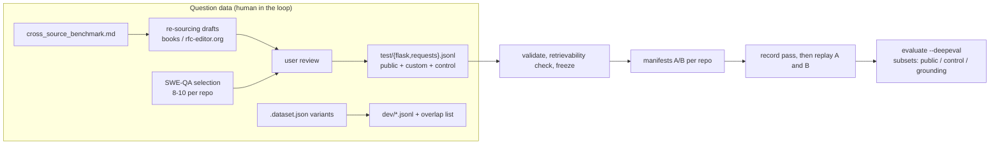

# Authored Benchmark Experiment - Plan

## Goal Capsule

- **Objective:** run the paper's paired A/B experiment on a re-sourced version of the authored cross-source benchmark (`data/questions/cross_source_benchmark.md`) plus 8–10 SWE-QA public questions per repository, for Flask 3.1.2 and Requests 2.32.5, and score it offline, including DeepEval diagnostics.
- **Authority:** this plan; then `docs/journal-extension-plan.md` (revised here for the test-set composition); then `docs/plans/2026-11-15-1948-feat-cross-source-qa-research-system-plan.md` for graph and run contracts. CLAUDE.md invariants bind (paired shared stages, frozen replayable web, evaluation only over saved traces).
- **Supersedes:** `docs/plans/2026-11-21-2200-feat-golden-graph-evaluation-plan.md` (untracked draft; delete it when this plan lands). `tests/eval/.dataset.json` stays only as the provenance record of the generated variants; nothing reads it.
- **Stop conditions:** stop before freezing if a human has not reviewed every agent-drafted or rewritten question.
- **Execution profile:** code units U1–U3 on one feature branch; data units U4–U5 need the user in the loop; U6 is operational (model and Tavily cost).

---

## Product Contract

### Summary

Make the experiment runnable on the new question set. The format gains a control type and allows single-source authored questions. Flask's PDF corpus becomes the three Flask books; Requests runs without PDFs and uses RFC web pages instead. Questions are re-sourced to match, SWE-QA public questions are added, and results are reported per question type, with DeepEval diagnostics defined for each type.

### Problem Frame

The 25-question benchmark was written against RFC PDFs, a book and the project paper, and as a DeepEval dataset. The harness cannot run it: `QuestionRecord` requires every custom question to cite code plus an external source (11 of 25 fit), has no unanswerable-control type, and questions name no repository. The user also wants the PDF corpus to be the three Flask books rather than the RFCs used during testing, and web evidence that respects the rule excluding project docs. Research for this plan established:

- The books are old: Grinberg 2nd ed. covers Flask 0.12.2, Aggarwal Flask 0.10.1; Aronowitz states no version and supports no question. Some book claims no longer hold for Flask 3.1.2 (`before_first_request`, `after_request` semantics, `werkzeug.contrib`, thread-local contexts).
- No book covers safe/idempotent methods or CGI variables, so items 8, 9 and 11 lose their evidence; items 12–15 and 17 can be re-sourced or rewritten against Grinberg (`data/questions/drafts/flask-book-resourcing.draft.md`).
- Requests' RFC items (10, 16, 18) and item 19 can cite RFC HTML pages on rfc-editor.org, which are not project sites (`data/questions/drafts/web-items.draft.md`).
- SWE-QA provides 48 questions per repository (`artifacts/swe-qa/`). The current development files hold 1 SWE-QA row and 2 AI-drafted custom questions per repository; those custom questions cite RFC PDF pages, which the new corpus policy removes.

### Requirements

- R1. `QuestionRecord` accepts three kinds: `public` (unchanged), `custom` (authored; at least one evidence span of any source type, with expected claims), and `control` (authored unanswerable; no evidence, no expected claims, expected outcome: decline). Each record exposes a grounding label derived from its evidence source types.
- R2. The test set per repository is the re-sourced authored questions plus 8–10 SWE-QA public questions, frozen with `dwb benchmark freeze`.
- R3. Flask's PDF corpus is the three books in `artifacts/books/`; Flask test runs index no RFCs. Requests runs have PDFs disabled.
- R4. Authored questions are re-sourced per the drafts: Flask items 12–15 and 17 against Grinberg; Requests items 10, 16, 18, 19 against rfc-editor.org pages; items 8, 9, 11 dropped; item 20 excluded (the paper is in no corpus). Every rewritten question keeps a link to its original item number. Four new Flask code+book questions (N1–N4 in `data/questions/drafts/flask-book-resourcing.draft.md`: teardown hooks, blueprint error handlers, blueprint `url_prefix`, `from_object`) join the set as drafts under KTD-B5.
- R5. Web questions: the four re-sourced Requests items plus three new code+web questions per repository. They are drafted by the agent, reviewed and edited by the user, and record that provenance.
- R6. Controls (items 21–25) are local-only: `web` is not in their `allowed_sources`. A control is correct when the answer declines (every claim is a "not established" claim); evidence recall and claim correctness are not applicable.
- R7. Development set: the existing development questions (1 SWE-QA row and 2 RFC-based custom questions per repository, the latter re-sourced to the new corpus policy) plus the generated variants whose parent survives, re-sourced like their parents. A variant-to-parent list documents the overlap for disclosure.
- R8. Every web-eligible test question has at least one gold URL that Tavily returns for its query, checked before freezing.
- R9. Reports group results by subset: `public`, `control`, and each authored grounding label, plus `all`.
- R10. DeepEval diagnostics run offline per the contract in KTD-B7 and never replace the claim-and-citation metrics.
- R11. New manifests per repository and condition pass `dwb experiment check`; runs get new IDs.
- R12. The journal plan, usage guide, architecture data model and question README describe the new composition and format.

### Scope Boundaries

- No changes to the graph or the web gate.
- No synthetic generation or tuning on test questions; the agent drafts only what the user accepted (web questions, book rewrites, N1–N4), and every draft is human-reviewed.
- The 12–15 public-question target and the optional conference migration replay are out.

### Deferred to Follow-Up Work

- A second reviewer's independent check of a stratified sample (journal plan); scheduled after freeze, before reporting.
- Removing the RFC PDF corpus files and indexes (kept for development and the chat defaults).

### Success Criteria

- Both repositories' test sets validate, freeze and pass `benchmark check` against their dev sets.
- Paired A/B runs complete with `web_capture_failed` 0, failures handled per KTD-B11, and `experiment evaluate --deepeval` writes per-subset tables.

---

## Planning Contract

### Key Technical Decisions

- **KTD-B1. Extend `QuestionRecord` rather than add a DeepEval-dataset runner input.** (session-settled: user-directed — chosen over a separate Golden adapter reading `tests/eval/.dataset.json`: one loader, and `benchmark validate`, `freeze` and `experiment run` keep working.)
- **KTD-B2. Kinds `public | custom | control`; grounding is derived, not stored.** The custom rule loosens from "code plus external" to "at least one span"; grounding comes from the evidence source types (`code`, `pdf`, `code+pdf`, `code+web`, ...). Controls carry a reference answer that states the decline, for the report and DeepEval only.
- **KTD-B3. Flask PDFs = the three books; Requests has no PDFs; Requests' RFC material moves to the web.** (session-settled: user-directed — chosen over keeping RFCs for Requests or adding books alongside RFCs: the testing PDFs must not be the evaluation corpus.) Book-sourced answers must hold for Flask 3.1.2; claims the books state for old versions are excluded.
- **KTD-B4. Test set = re-sourced authored questions + 8–10 SWE-QA public per repository.** (session-settled: user-directed — chosen over authored-only and over 12–15 public: doubles the code-heavy questions where A and B differ, at moderate curation cost.) Public rows are chosen with prespecified criteria: cross-file behaviour preferred, named symbols present at the pinned SHA, reference answer consistent with the pinned code, not a development row.
- **KTD-B5. Agent-drafted questions are allowed only as drafts under human review.** (session-settled: user-directed — the user asked the agent to research and write the web questions, over authoring them all; the four new book questions N1–N4 were accepted on the same terms.) `provenance.author` names the reviewer and `provenance.edits` records "drafted by Claude, reviewed by <author>"; the paper discloses it. Drafting and review happen without opening the generated wikis or any condition's traces, review notes about which condition could cite what are removed before freeze, and the paper states that drafting happened after the wikis were generated (the journal plan asks for authoring before consulting wiki coverage).
- **KTD-B6. Generated variants are development questions.** (session-settled: user-directed — chosen over excluding them.) A variant whose parent was dropped is dropped; the others are re-sourced like their parents. `benchmark check` compares exact text only, so the variant-to-parent list in `data/questions/README.md` is the disclosure record.
- **KTD-B7. DeepEval diagnostics contract.** DeepEval runs as a library inside `experiment evaluate --deepeval`, over the saved and hydrated traces, with the pinned judge model from `configs/eval.yaml` (not the generator). Per question:
  - inputs: `input` = question, `actual_output` = rendered answer, `retrieval_context` = text of the final-context items (code read back from the checkout, PDF and web text from the trace), `expected_output` = reference answer, or the expected claims joined;
  - answerable questions (public and custom, any grounding): Contextual Recall (did the final context contain what the reference needs) and Faithfulness (are the answer's statements supported by that context);
  - controls: Contextual Recall is not applicable and is skipped (the reference is a decline); Faithfulness runs, because it catches made-up answers to unanswerable questions;
  - skipped with a reason when there is no answer or no final context; failed questions get no diagnostics (their correctness is already 0);
  - each metric's `evaluation_cost` is recorded; results go to `deepeval_diagnostics.csv` per question and to a per-subset, per-condition summary. DeepEval's metric prompts are not temperature-pinned, so the diagnostics are reported as secondary and their package version is recorded.
- **KTD-B8. `allowed_sources` policy.** Authored answerable questions allow every local source the repository has (Flask: code+pdf; Requests: code); only code+web questions also allow `web`. Controls are local-only. Public questions stay code-only (no web). The web gate stays on, so web runs for a code+web question only when the judge finds the local evidence insufficient; that outcome is reported, not forced.
- **KTD-B9. Measure web retrievability before freezing; do not filter on it.** A Tavily pass queries each web-eligible question's text exactly as the graph sends it, with the manifest's `max_results`, `search_depth` and `exclude_domains`, and counts a hit only when an evidence alternative matches a returned passage under the evaluator's rules (URL without fragment plus passage overlap). One equivalence rule is fixed in advance: an RFC cited on rfc-editor.org also matches its official copies on datatracker.ietf.org and httpwg.org. Questions are not reworded, re-sourced or dropped because of the result, so web-stage recall stays an unconditioned estimate. Each question's pre-check result goes in its provenance. *Revised 2026-11-22:* the first pass (`data/questions/drafts/webcheck-2026-11-22.json`) retrieved gold for 1 of 9 web test questions, because the raw question text is a poor web query; filtering on that would have tuned the test set to the retriever. The web stage is shared by both conditions, so the primary A/B comparison does not depend on it.

- **KTD-B10. Primary analysis is fixed before the runs.** The primary A/B comparison is per repository, over the condition-sensitive questions: public questions plus authored answerable questions that need code evidence (code, code+book, code+web). It reports paired differences and improved/tied/regressed counts, as the journal plan specifies. Book-only questions and controls are sanity checks expected to show no A/B difference. Any subset with fewer than about 10 questions is reported as descriptive counts, without a comparative claim.
- **KTD-B11. Failures are scored, not rerun away.** A failed question scores 0. A rerun is allowed only for an infrastructure fault (provider outage, timeout), applies to both conditions for that question, and is logged with its cause.

### High-Level Technical Design

Final allocation (counts change only through review):

| Repository | Authored answerable | Controls | Public | Total |
|---|---|---|---|---|
| Flask | code 1–6; book 12′, 13; code+book 14′, 15′, 17′, N1–N4; code+web ×3 | 21, 23, 25 | 8–10 | ~29–31 |
| Requests | code 7; code+web 10′, 16′, 18′, 19′ + 3 new | 22, 24 | 8–10 | ~18–20 |

### Assumptions

- The user (and a second reviewer later) can review roughly 20 drafted or rewritten questions and 16–20 SWE-QA rows before the freeze.
- Indexing the books (~670 pages) fits the embedding budget.

### Sequencing

U1 → U2 (code) and U3 (config) can proceed in parallel after U1; U4 needs U1 (to validate records); U5 needs U3, U4 and U8; U6 needs U2 and U5; U7 follows U4 and is finalised after U6.

---

## Implementation Units

### U1. Question format: control kind and single-source authored questions

**Goal:** `QuestionRecord` represents every question type in the new set.
**Requirements:** R1, R6; KTD-B1, KTD-B2.
**Dependencies:** none.
**Files:** `src/dwb/benchmark/schemas.py`, `src/dwb/curation.py`, `tests/benchmark/test_schemas.py`, `tests/test_curation.py`.
**Approach:**
1. Add `control` to `kind`; a control must have no evidence and no expected claims, must not allow `web`, and needs `provenance.author`.
2. Relax the `custom` rule to require at least one evidence span (any type) plus expected claims and an author.
3. Add a derived grounding label from the evidence source types for every record. `public` and `control` are report subset names, not grounding labels.
4. Count controls in the curation summary.
**Test scenarios:**
- A custom question with only code evidence validates; so does one with only PDF evidence.
- A custom question with no evidence fails.
- A control with an evidence span, with expected claims, or allowing web fails; a valid control passes.
- A public question still rejects `web` and still needs upstream row IDs.
- Grounding labels: code+pdf evidence gives `code+pdf`; code-only gives `code`; a control gives `control`.
- The curation summary counts public, custom and control.
**Verification:** schema and curation tests pass; existing test records still load.

### U2. Evaluation: control scoring, subsets, DeepEval contract

**Goal:** the report scores controls correctly, groups results by subset, and runs DeepEval per KTD-B7.
**Requirements:** R6, R9, R10; KTD-B7.
**Dependencies:** U1.
**Files:** `src/dwb/eval/report.py`, `src/dwb/eval/command.py`, `src/dwb/eval/deepeval_diag.py`, `src/dwb/eval/claims_judge.py`, `tests/eval/test_report.py`, `tests/eval/test_deepeval_diag.py`.
**Approach:**
1. Per-question rows gain `subset` (public, control or grounding label) and `control_correct` (controls only: 1 when the answer declines, else 0), added to the paired metrics (higher is better). Controls branch before the failed-trace path: the claim judge is never called for them, correctness and recall are null, and a failed control scores `control_correct` 0.
2. The paired summary iterates over the subsets present plus `all`, replacing the fixed public/custom split.
3. DeepEval: skip Contextual Recall for controls; record each metric's evaluation cost; write a per-subset, per-condition summary next to `deepeval_diagnostics.csv`; record the DeepEval version in the evaluator config.
**Test scenarios:**
- A control trace whose claims are all gap claims scores `control_correct` 1 with correctness and recall null and no judge call.
- A control trace with an answer claim scores 0.
- A failed control scores `control_correct` 0 with no judge call, and `control_correct` appears in the paired summary.
- The paired summary for a set with public, code and code+pdf questions has one block per subset plus `all`.
- The DeepEval test case for a control has no Contextual Recall entry and a Faithfulness entry (with the metric stubbed).
- A failed trace produces no DeepEval row; an empty-context trace is skipped with a reason.
- Metric cost is recorded when the metric reports one.
**Verification:** eval tests pass; evaluating the existing development runs still works.

### U3. Corpora and manifests

**Goal:** both repositories' configurations match the new corpus policy.
**Requirements:** R3, R11; KTD-B3, KTD-B8.
**Dependencies:** none for the files; the index build needs the books present.
**Files:** `configs/pdfs/flask.yaml` (new corpus ID listing the three books), `configs/pdfs/flask-rfc.yaml`, `configs/manifests/*-dev.yaml`, `configs/manifests/{flask,requests}-{A,B}.yaml`, `configs/chat.yaml`, `tests/test_manifest.py`.
**Approach:**
1. Point `configs/pdfs/flask.yaml` at the three books under a new corpus ID, and keep `configs/chat.yaml` `repos.flask.pdf_corpus` on that file, because `benchmark validate` and `freeze` resolve PDF spans through it. Move the RFC list to `configs/pdfs/flask-rfc.yaml`, used only explicitly.
2. Requests manifests: `pdf_enabled: false`, no PDF index.
3. Add `werkzeug.palletsprojects.com` to Flask's `web.exclude_domains`; new Tavily store IDs for both repositories (exclusions change request keys).
4. New run IDs; the question-set path points at the test files, with the hash filled at freeze (U5).
5. Add development manifest pairs per repository (`configs/manifests/<repo>-{A,B}-dev.yaml`) with the same corpus, PDF and web settings, `question_set.path` on the dev file and `hash: null`, for the U6 pilot.
6. Build the Flask book index with `dwb index pdf` and record its ID.
**Test scenarios:**
- Shipped test and dev manifests load and each A/B pair passes `check_paired`.
- A Requests manifest with PDFs disabled needs no PDF index ID.
**Verification:** `dwb experiment check` passes for both pairs (with the hash still unset); the book index builds and its ID is in the Flask manifests.

### U4. Question data: re-source, review, convert

**Goal:** reviewed test and development JSONL for both repositories.
**Requirements:** R2, R4, R5, R6, R7; KTD-B4, KTD-B5, KTD-B6, KTD-B8.
**Dependencies:** U1.
**Files:** `data/questions/drafts/web-items.draft.md`, `data/questions/drafts/flask-book-resourcing.draft.md`, `data/questions/selections/{flask,requests}.yaml`, `data/questions/test/{flask,requests}.jsonl`, `data/questions/dev/{flask,requests}.jsonl`, `data/questions/README.md`, `data/questions/cross_source_benchmark.md`.
**Approach:**
1. The user reviews the two draft files and accepts, edits or rejects each item; the flagged items (Werkzeug-only behaviour, the OPTIONS overlap between item 14′ and flask-web-new-3, code-comment hints) are resolved here.
2. For each book-sourced question, list the book claims known to be stale for Flask 3.1.2 (from the book draft) in `notes`, so stale-but-retrieved claims can be recognised during audit.
3. Convert accepted authored questions to `custom` or `control` records with expected claims, evidence spans (code lines, physical book pages, web URL plus passage), `allowed_sources` per KTD-B8 and provenance per KTD-B5; keep the original item number in `notes`.
4. Apply the KTD-B4 eligibility criteria to every non-development SWE-QA row and record each exclusion with its reason; draw 8–10 eligible rows per repository by a seeded random sample (optionally stratified by cross-file vs local) and record the seed in the selection file; run `dwb benchmark draft`, and verify each reference answer against the pinned code.
5. Build the development files: the existing SWE-QA development row per repository, the four RFC-based custom development questions re-sourced (Flask: books or web; Requests: code+web on rfc-editor.org), and the surviving variants, re-sourced; list each variant against its parent in the README.
6. Update `cross_source_benchmark.md` to the re-sourced versions, marking dropped and excluded items with reasons.
**Execution note:** the user does the review; the agent converts and validates only accepted items.
**Test expectation:** none -- data; `dwb benchmark validate` is the check (U5).
**Verification:** every accepted question is in exactly one test file; `benchmark validate` reports no problems for either repository.

### U5. Retrievability measurement and freeze

**Goal:** frozen, runnable test sets.
**Requirements:** R2, R8, R11; KTD-B9.
**Dependencies:** U3, U4 (U8 replaced by a one-off script).
**Files:** `data/questions/test/*.jsonl.sha256`, `configs/manifests/*.yaml`, Tavily store under `artifacts/tavily/`.
**Approach:**
1. Run the retrievability check over the web-eligible test questions and record each result in provenance (KTD-B9; misses are kept).
2. `dwb benchmark validate`, then `freeze`; copy the hashes into the manifests; `dwb benchmark check <dev> <test>` per repository.
3. `dwb experiment check` per pair.
**Test expectation:** none -- operational gate.
**Verification:** every web-eligible question has its pre-check result in provenance; freeze, check and experiment check pass.

### U6. Pilot and paired runs

**Goal:** paired traces and reports for the paper.
**Requirements:** R11, R9, R10.
**Dependencies:** U2, U5.
**Files:** outputs only (`runs/`, `reports/`).
**Approach:**
1. Pilot: run the development set through A and B per repository (dev manifests from U3); evaluate; inspect failures and DeepEval skips. Prompt or configuration changes may only be driven by failures on non-variant development questions; variants run only as a harness smoke test (format, control scoring, DeepEval skips). (session-settled: user-directed — chosen over allowing variant-driven changes with disclosure: variants reword test questions.)
2. Per repository: a record pass to capture web for all eligible questions (check `web_capture_failed` is 0), then the paired A and B runs in replay mode.
3. `dwb experiment evaluate runs/<A> runs/<B> --out reports/<repo>-test --deepeval`.
**Test expectation:** none -- operational.
**Verification:** failures are scored and logged per KTD-B11; reports contain per-subset tables, `web_gate.csv` and the DeepEval summary.

### U8. Web retrievability check command

**Goal:** a runnable pre-freeze check for KTD-B9 (no existing command can search Tavily for an unfrozen test file).
**Status (2026-11-22): not built.** The one pre-check ran as a throwaway script before the freeze (report: `data/questions/drafts/webcheck-2026-11-22.json`); under the revised KTD-B9 the result is recorded, not acted on, so a command adds no value until a new test set is curated.
**Requirements:** R8; KTD-B9.
**Dependencies:** U1.
**Files:** `src/dwb/curation.py`, `src/dwb/cli.py`, `tests/test_curation.py`.
**Approach:** add `dwb benchmark webcheck <records> <manifest>`. It opens the manifest's Tavily store in record mode with the manifest's web settings, searches each web-eligible record's question text exactly as the graph does, and reports per question whether any web evidence alternative matches a returned passage under the evaluator's matching rules. It writes nothing besides the Tavily store records.
**Test scenarios:**
- A record whose gold URL and passage come back from a stub client reports a hit.
- A returned page with the gold URL but too little passage overlap reports a miss.
- A record that does not allow web is skipped.
- Results already in the store are reused without a new Tavily call.
**Verification:** curation tests pass; the command runs against a stub store.

### U7. Documentation

**Goal:** the docs describe the experiment as run.
**Requirements:** R12.
**Dependencies:** U4; final numbers after U6.
**Files:** `docs/journal-extension-plan.md` (test-set section), `docs/usage.md` ("Building the test set": control kind, grounding, allowed-sources policy), `docs/architecture.md` (data model), `data/questions/README.md`, `CLAUDE.md` (if the test-set description changes).
**Test expectation:** none -- documentation.
**Verification:** the journal plan's composition matches the frozen files; the usage guide explains how to write a control.

---

## Verification Contract

- `conda run -n taxonomy pytest` and `conda run -n taxonomy ruff check src tests` pass after U1–U3.
- `dwb benchmark validate`, `freeze` and `check` pass for both repositories (U5).
- `dwb experiment check` passes for both A/B pairs.
- Every web-eligible test question carries its retrievability pre-check result.

## Definition of Done

- R1–R12 hold; every test-set question is human-reviewed and frozen.
- Paired runs and reports exist for both repositories with no failed web captures and failures handled per KTD-B11.
- The superseded draft plan is removed; no abandoned code remains in the diff.

## Deferred to Implementation

- The exact grounding label strings and the subset ordering in the report.
- Which SWE-QA rows are selected (U4, by the user against the criteria in KTD-B4).

## Open Questions

- Deferred: should Aronowitz stay in the Flask corpus as a distractor, given it supports no question? Default: keep it, since the user chose all three books.
- Deferred: second-reviewer sample size and timing.

## Sources

- Conversation of 2026-11-22 (benchmark assessment; user decisions on format, corpus, SWE-QA mix, variants and web questions).
- `data/questions/cross_source_benchmark.md`; `tests/eval/.dataset.json` and `tests/eval/README.md`.
- `data/questions/drafts/flask-book-resourcing.draft.md` and `data/questions/drafts/web-items.draft.md` (agent research, needs review).
- `docs/journal-extension-plan.md` (test-set design, lines 16–22; evaluation, lines 84–90).
- `src/dwb/benchmark/schemas.py`, `src/dwb/eval/deepeval_diag.py`, `src/dwb/eval/report.py`, `configs/eval.yaml`, `artifacts/swe-qa/`.
