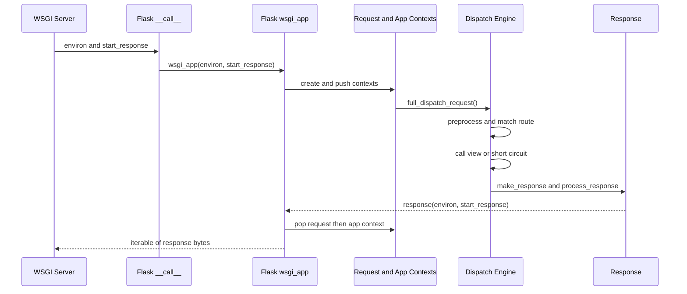
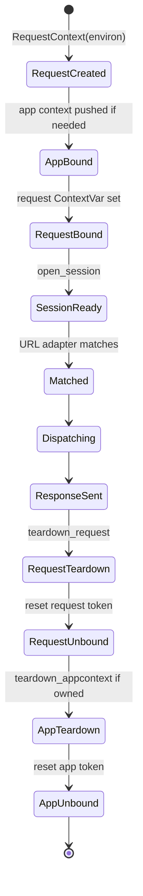
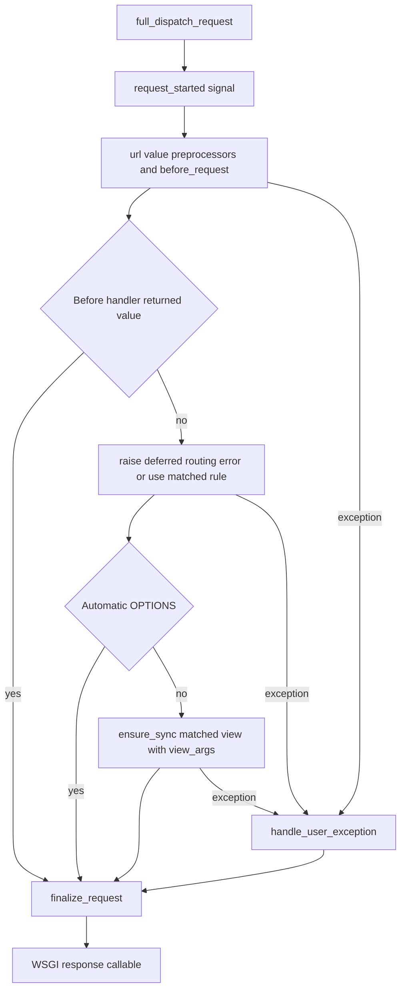

# WSGI Runtime, Contexts, and Dispatch Engine

Flask remains a **WSGI application**. The WSGI server calls `Flask.__call__`, which delegates to `wsgi_app(environ, start_response)`. Flask constructs and binds request state, dispatches the route, converts the handler result to a `Response`, invokes the WSGI response callable, and finally tears down the contexts. Middleware can wrap `app.wsgi_app` while the original `Flask` object remains available ([`app.py`](../../src/flask/app.py#L1479-L1536)).

This page describes the runtime engine rather than application setup; setup and ownership are covered in [the application model](application-model.md). The public context-facing view is also summarized in [contexts and proxies](../concepts/contexts-and-proxies.md), while operational lifecycle guidance belongs in [the request lifecycle workflow](../workflows/request-lifecycle.md).

## End-to-end WSGI call path

*The normal request path, including response emission before context teardown.*

`RequestContext.__init__` creates the Flask `Request` from the WSGI environment and attempts to create its URL adapter. A routing `HTTPException` is retained in `request.routing_exception` for dispatch to raise later. `RequestContext.push` first ensures an app context for the same application, then binds the request context, opens the session, and only then matches the URL. Loading the session before matching is intentional: custom URL converters can use session data ([`ctx.py`](../../src/flask/ctx.py#L303-L330), [`ctx.py`](../../src/flask/ctx.py#L367-L393)).

## Contextvars and proxies

Flask stores the current `AppContext` and `RequestContext` in separate Python `ContextVar`s, `_cv_app` and `_cv_request`. Werkzeug `LocalProxy` exposes `current_app` and `g` through the app variable, and `request`, `session`, and `request_ctx` through the request variable. Access outside the corresponding context raises the proxy's “Working outside of ... context” `RuntimeError` ([`globals.py`](../../src/flask/globals.py#L17-L51)).

The app context owns the application reference, a URL adapter for app-level URL building, and an `_AppCtxGlobals` namespace used by `g`. The request context owns the request, URL adapter, session, matched rule and view arguments. Contexts are token-based rather than a single mutable global, so nested contexts can temporarily change what proxies resolve to and `pop` restores the previous value. Request context copying reuses the same request object and session; it is therefore useful for moving context to a greenlet, but does not make concurrent access to the request object safe ([`ctx.py`](../../src/flask/ctx.py#L222-L281), [`ctx.py`](../../src/flask/ctx.py#L341-L353)).

*The ownership-sensitive push/pop lifecycle; an already-active matching app context is not popped by this request.*

## Dispatch and routing

`full_dispatch_request` marks that the app has handled its first request, emits `request_started`, and runs `preprocess_request`. Preprocessing runs URL-value preprocessors and then `before_request` functions in app/blueprint order. A non-`None` before result becomes the response and skips the view. Otherwise `dispatch_request` raises a deferred routing exception, returns Flask’s automatic `OPTIONS` response when the rule requests it, or calls the matched endpoint with `request.view_args` ([`app.py`](../../src/flask/app.py#L879-L920), [`app.py`](../../src/flask/app.py#L1261-L1290)).

Class-based views are an extension point within this same dispatch path, not a second runtime. `View.as_view` creates the registered function, optionally instantiates a view per request, and calls `dispatch_request`; `MethodView` selects the method named by the HTTP verb and falls back from `HEAD` to `GET`. Both use `current_app.ensure_sync` ([`views.py`](../../src/flask/views.py#L38-L125), [`views.py`](../../src/flask/views.py#L143-L191)).

*Dispatch branches: a before hook can short-circuit; routing and view failures enter user exception handling before finalization.*

## Response finalization and failure paths

`finalize_request` first calls `make_response`, so a view, before hook, or error handler may return a supported response value rather than a `Response`. It then runs per-request `after_this_request` callbacks in registration order, application and blueprint `after_request` callbacks in reverse registration order, saves a non-null session, and emits `request_finished`. If response processing fails while handling an error, `from_error_handler=True` logs the failure and preserves the already-created error response; on the normal path the processing exception is re-raised ([`app.py`](../../src/flask/app.py#L922-L964), [`app.py`](../../src/flask/app.py#L1292-L1325)).

There are two meaningful exception layers:

- Exceptions raised during preprocessing, routing, or the view go through `handle_user_exception`. HTTP exceptions normally become their HTTP response (unless trapped); registered handlers are selected by exception/code and invoked through `ensure_sync`. With no applicable handler, the exception is re-raised to the outer WSGI boundary.
- `wsgi_app` catches that unhandled exception and calls `handle_exception`. It emits `got_request_exception`; with `PROPAGATE_EXCEPTIONS` (implicitly debug or testing when unset), it re-raises. Otherwise it logs, creates `InternalServerError(original_exception=e)`, invokes a 500 handler if present, and finalizes that error response in safe mode. Teardown still receives the original exception ([`app.py`](../../src/flask/app.py#L770-L850), [`app.py`](../../src/flask/app.py#L1507-L1529)).

The distinction matters: an error handler’s successful return is finalized like any other result, while an unhandled failure during finalization itself is not silently converted on the normal path. In all cases where `wsgi_app` reaches its `finally` block, it calls `ctx.pop(error)`, including failures from response iteration setup or the WSGI response call.

## Teardown and signals

Teardown is owned by context pop, not by successful dispatch. Request pop runs registered `teardown_request` functions in reverse order, then emits `request_tearing_down`, closes the request if it has `close`, resets the request `ContextVar`, and pops the app context only when this request pushed it. App pop runs reversed `teardown_appcontext` functions, emits `appcontext_tearing_down`, resets its token, checks that the expected context was popped, and emits `appcontext_popped` ([`ctx.py`](../../src/flask/ctx.py#L395-L449), [`ctx.py`](../../src/flask/ctx.py#L251-L278), [`app.py`](../../src/flask/app.py#L1326-L1385)). Teardown callbacks receive the exception, or `None` for a successful request; they must not assume that every earlier dispatch callback completed.

The signal ordering relevant to a request is:

1. `appcontext_pushed` during app push.
2. `request_started` before preprocessing.
3. `got_request_exception` when an unhandled exception enters `handle_exception`.
4. `request_finished` after response postprocessing succeeds (including normal error-handler finalization).
5. `request_tearing_down` after request teardown callbacks.
6. `appcontext_tearing_down` after app teardown callbacks.
7. `appcontext_popped` after the app token is reset.

Signals and callback dispatch use `_async_wrapper=self.ensure_sync`, so signal receivers may be synchronous or coroutine functions where the signal integration supports them ([`signals.py`](../../src/flask/signals.py#L1-L17), [`app.py`](../../src/flask/app.py#L1326-L1385)).

## Async handlers are synchronously bridged

Flask does not become an ASGI server when a route or lifecycle callback is declared with `async def`. `ensure_sync` returns ordinary functions unchanged and wraps coroutine functions with `async_to_sync`; the default implementation uses `asgiref.sync.async_to_sync`, requiring the `async` extra. Thus the WSGI worker waits for the coroutine’s result. An async view can perform concurrent I/O inside its event loop, but each request still occupies one WSGI worker, and unfinished background tasks are cancelled when the view completes ([`app.py`](../../src/flask/app.py#L966-L1001), [`async-await.rst`](../../docs/async-await.rst#L28-L58)).

The bridge is deliberately overridable: applications and extensions can override `Flask.ensure_sync` or `async_to_sync`, and extension wrappers should call `current_app.ensure_sync(func)` before invoking a possibly async callback. The same bridge is used for views, error handlers, before/after/teardown functions, and signal receivers; it is the synchronization boundary rather than an alternate server protocol ([`async-await.rst`](../../docs/async-await.rst#L93-L125), [`app.py`](../../src/flask/app.py#L966-L1001)).

## Safe extension points and invariants

- Replace `request_class` or `response_class` on the app to customize the concrete request/response objects; customize URL matching through a `RequestContext` subclass’s `match_request` when needed ([`app.py`](../../src/flask/app.py#L206-L220), [`ctx.py`](../../src/flask/ctx.py#L359-L365)).
- Override `wsgi_app` or wrap `app.wsgi_app` for WSGI middleware; preserve `__call__` as the server-facing entry point.
- Override `ensure_sync`/`async_to_sync` for a different async integration, but do not describe that as changing Flask’s WSGI contract.
- Treat `g` as context-scoped scratch storage, not cross-request persistence. Teardown is the right boundary for releasing resources cached there ([`appcontext.rst`](../../docs/appcontext.rst#L78-L125)).
- Preserve push/pop pairing and token ownership. Popping the wrong context raises an assertion, and an already-active app context belonging to another app is not reused; a request pushes its own app context instead.
